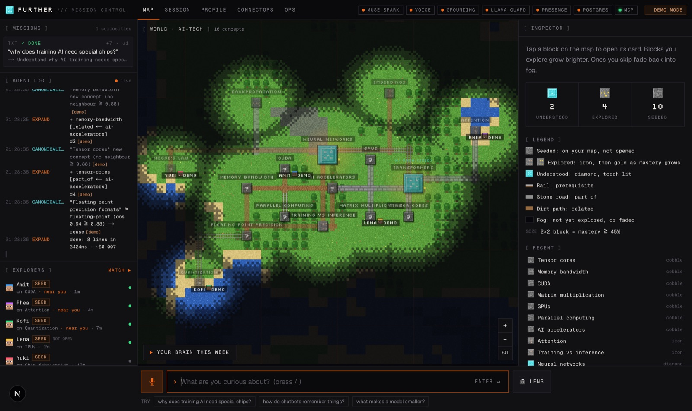

# Further

*Your feed knows what keeps you scrolling. Further knows what you're trying to understand.*

Say what you're curious about, even vaguely. A concept map grows from that sentence, one block at a time. Every block has one short, real, cited source. Blocks you explore turn from cobblestone to iron, gold and diamond; ones you skip fade back into fog. When someone nearby on the map is a step ahead on a neighbouring concept, you can both accept a short AI-facilitated session where each of you teaches the piece you know.



## Run it

Requires Node 20+.

```bash
npm install
npm run dev        # http://localhost:3000
```

With no keys, every AI and realtime system runs in **demo mode**: labeled demo data, no network calls to Meta, no charges. The top bar shows each system's status (green live, orange demo). Copy `.env.example` to `.env.local` and add keys to switch systems to live one at a time.

```bash
npm run typecheck
npm run build
```

## The demo (3 minutes)

| # | Beat | Where |
|---|---|---|
| 1 | Voice → bloom: tap the mic, say "why does training AI need special chips?" | Map, command bar |
| 2 | Tap **Matrix multiplication**: hook with citation, verified clip, flowchart, explain it back | Inspector |
| 3 | **Your brain this week**: the map replays day 1 → now | Map, bottom left |
| 4 | Match request (60s), both accept, jigsaw session, both maps update | Match modal → `/session` |
| 5 | From any MCP client: `add_curiosity("what is HBM memory")`. The node appears on the open map | `/connectors` (or a real client) |

## Screens

| Route | What it's for |
|---|---|
| `/` | Mission control: missions, live agent log, explorers, world map, inspector, command bar |
| `/session` | Jigsaw room: phases, facilitator, Llama Guard on every message, block/report |
| `/profile` | Three-layer profile, matching settings, MCP token, inventory |
| `/connectors` | MCP server details, tools, and a live JSON-RPC console |
| `/ops` | Every agent, Meta model, requirement and production check, with live/demo status and code location |

## Code map

```
app/
  page.tsx                 mission control (map screen)
  session/ profile/ connectors/ ops/
  api/
    expand/                F2  SSE streaming expansion + canonicalization
    transcribe/            F1  Muse Voice Transcribe
    card/[slug]/           F3  node card
    resources/verify/      F3  oEmbed / HTTP source check (live, host-allowlisted)
    explain/               F4  rubric grading
    match/                 F7  scoring + handshake decisions
    session/[id]/message/  F8  Llama Guard → broadcast → facilitator
    mcp/                   F10 JSON-RPC MCP server
    inbox/                 demo stand-in for Supabase Realtime
    health/                status pills
components/
  map/                     canvas world: pixel textures, fog, blocks, paths, heads
  mission/                 left rail, inspector, command bar, match modal, time-lapse
  shell/ ui/
lib/
  math.ts                  bloom/fade math (plan §5.4), shared by map + time-lapse + server
  matching.ts              match score (plan §5.5)
  canonicalize.ts          cosine + threshold, demo embedding
  schemas.ts               Zod for every API boundary
  requirements.ts          the table rendered on /ops
  client/                  store (event log is the source of truth) + hooks
  server/                  config, Meta client, moderation, rate limit, observability
  demo/seed.ts             all demo data, in one place
supabase/migrations/       schema + RLS (plan §5.1)
docs/DESIGN.md             design process, decisions, requirement map, iteration log
```

## For backend owners

Each system has a typed seam. Fill in the live branch; the UI doesn't change.

- **Connor:** `lib/server/meta.ts` (Muse Spark, transcribe), `app/api/expand` (swap demo embedding for pgvector), `app/api/card` (grounding), `app/api/mcp` (move to the official TS SDK), RLS/rate limit/Sentry.
- **Amit:** Presence channel `explorers` + 15s scoring job using `lib/matching.ts`, `match_requests` handshake, Broadcast `session:{id}`, `lib/server/moderation.ts` (Llama Guard).
- **Manpinder:** `lib/demo/seed.ts` (seed concepts, explorers, sources), eval set for the 0.88 canonicalization threshold.
- **Sirpreet:** everything in `components/`, `docs/DESIGN.md`.

## Honesty rules

Demo data is always labeled `DEMO` / `SEED` in the UI. Seed explorers are never presented as real people, and demo grades, transcripts and facilitator turns are never presented as live model output.
