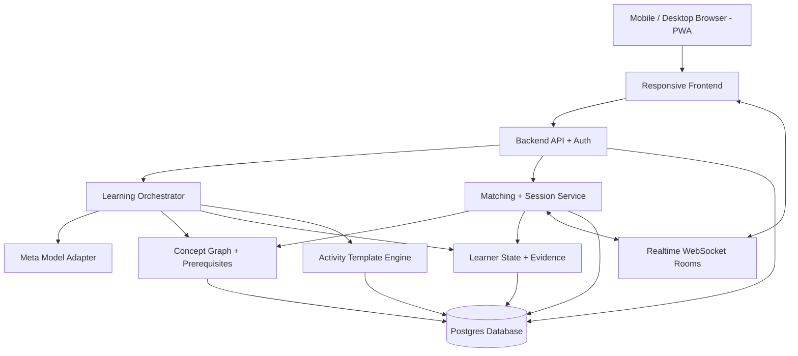

# Discover · Learn · Connect — System Architecture
## Technical blueprint and Muse implementation contract

**Status:** Proposed architecture for a hackathon MVP, with a path to production. **Target:** Responsive web app / installable PWA, usable on mobile and desktop. **AI requirement:** Build using Muse; route runtime generation and reasoning through available, authorized **Meta model APIs**. Confirm exact model names, endpoints, quotas, and capabilities in the hackathon environment before implementation; do not fabricate integrations.

## 1. System overview



### Recommended hackathon stack
- **Client:** Next.js / React + TypeScript, mobile-first CSS, accessible UI, PWA manifest; SVG/HTML interactive activities.
- **Server:** Next.js API routes or separate Node/TypeScript service. Use one backend stack to minimize integration overhead.
- **Realtime:** WebSockets (e.g., Socket.IO) for room presence, synchronized challenge state, and chat. Persist authoritative state server-side.
- **Data:** PostgreSQL (hosted option acceptable), with JSONB for activity payloads and learner evidence. Optional Redis later for presence and queues.
- **AI:** A single server-side `MetaModelProvider` interface. All calls use documented Meta models available to the team. Keep API credentials on the server only.
- **Deploy:** One web service + managed database for MVP. Use environment-based configuration, migrations, and seeded demo data.

## 2. Core product services

| Service | Responsibility | MVP behavior |
|---|---|---|
| Discovery | Search, suggest related concepts, surface next steps | Curated starter concepts + AI semantic interpretation |
| Concept graph | Concepts, prerequisites, related nodes, difficulty | Seed a validated graph for GPU/parallel computing; limited calculus sample |
| Learner model | Interests, goals, tentative skill, evidence, preferences | Per-concept state and confidence; never claim formal certification |
| Learning orchestrator | Choose next objective, format, hint, and reflection | Rules + Meta-model structured output |
| Activity engine | Render reusable learning interactions | Guided explanation and collaborative challenge |
| Matching | Find compatible peers when beneficial | Hard constraints + weighted score + opt-in |
| Room service | Presence, chat, activity state, moderation controls | 2–3 users, real-time text, leave/report/block |
| Assessment | Independent understanding and next-step recommendation | Pre/post novel question + rubric-based evaluation |

## 3. Learning engine: a decision loop

```text
User interest / goal
  -> Normalize into concept(s)
  -> Identify prerequisites and ask brief calibration questions
  -> Select next learning objective
  -> Select activity template (or guided explanation)
  -> Generate validated structured activity content via Meta model
  -> User attempts / explains / collaborates
  -> Evaluate evidence and uncertainty
  -> Update learner state
  -> Recommend continue, remediate, branch, or collaborate
```

**Do not equate clicks with mastery.** Track at least `unseen`, `exploring`, `practicing`, and `demonstrated` states; add confidence and timestamps. Assessment should include transfer questions the learner has not just seen. Allow a user to correct the system's assumptions. Treat model judgments as provisional.

**Long-term learning:** Store journeys as a goal plus graph traversal history, not one enormous generated course. A calculus journey can span functions → limits → derivatives → integrals, with branches and prerequisite remediation. Users can switch between short discovery and deep pursuit without losing state.

## 4. Activity architecture

The model generates **content**, not executable JavaScript. It returns JSON matching a versioned schema for a known template. Validate against a schema before rendering. If invalid, retry within budget or fall back to a safe authored activity.

```json
{
  "schemaVersion": 1,
  "template": "collaborative_challenge",
  "conceptId": "gpu.parallelism",
  "objective": "Explain why parallel workloads suit GPUs",
  "durationMinutes": 6,
  "steps": [
    {"type": "predict", "prompt": "Which workload benefits most from many parallel workers?", "choices": ["One sequential task", "Many independent tasks"]},
    {"type": "discuss", "prompt": "Compare your reasons and agree on an answer."},
    {"type": "apply", "prompt": "Assign 100 independent tasks to workers and explain your choice."}
  ],
  "reflectionPrompt": "Explain when parallelism helps and when it does not."
}
```

Future templates: simulations, roleplays, debates, projects, and longer practice sessions. **MVP:** two polished, touch-friendly templates with server-controlled step progression and consistent accessible controls. Use SVG/canvas only where needed; offer textual equivalents.

## 5. When to recommend multiplayer

Collaboration is **optional and context-triggered**. Consider a match when (a) a concept benefits from debate, explanation, roleplay, or shared problem solving, (b) the learner opts in, and (c) compatible participants are available. Avoid interruptions during focused solo work; show a dismissible suggestion at a natural transition.

**Hard filters:** Adult-only MVP, opt-in, compatible language/translation support, overlapping availability, blocked-user exclusions, and safety restrictions.

**Soft ranking:** Concept overlap, compatible knowledge gaps, activity preference, desired duration, and likelihood of a productive shared objective. Do not assume the highest-skill person will teach. A matched room must have an AI-generated goal, roles/prompts, and a completion condition.

**Cold start:** If no peers are online, offer solo activity, a waitlist, or a scheduled session. Demo can seed users but must label simulated users clearly; showcase real synchronized browser sessions where possible.

## 6. Data model (minimal)

```text
users(id, display_name, locale, created_at)
learner_preferences(user_id, formats_json, goals_json, session_duration)
concepts(id, title, description, domain, verified_version)
concept_edges(from_id, to_id, relation)  # prerequisite / related
learner_concepts(user_id, concept_id, state, confidence, updated_at)
learning_evidence(id, user_id, concept_id, activity_id, response_json, rubric_json, created_at)
journeys(id, user_id, goal, current_concept_id, status)
activities(id, concept_id, template, payload_json, schema_version, status)
sessions(id, concept_id, activity_id, status, started_at, ended_at)
session_members(session_id, user_id, joined_at, left_at)
messages(id, session_id, user_id, text, created_at)
reports(id, reporter_id, reported_user_id, session_id, reason, status)
blocks(blocker_id, blocked_id)
```

Use authorization on every resource. Store only needed learner data; define deletion and retention policies before a public launch. Never expose private learner responses to other participants by default.

## 7. API and realtime contracts (suggested)

| Route/event | Purpose |
|---|---|
| `POST /api/learning/interpret` | Topic text → concepts and proposed starting point |
| `POST /api/learning/calibrate` | Short check → provisional knowledge profile |
| `POST /api/learning/next` | Next objective and activity suggestion |
| `POST /api/activities/generate` | Meta-model structured activity payload |
| `POST /api/activities/:id/submit` | Record response and assessment evidence |
| `GET /api/journeys/:id` | Progress and concept graph |
| `POST /api/matches/suggest` | Eligible peers and proposed shared objective |
| `POST /api/sessions` | Create opt-in session |
| `room:join`, `room:leave` | Presence lifecycle |
| `chat:send`, `activity:action` | Moderated chat and authoritative shared state |
| `session:updated` | Broadcast current room/activity state |

Validate requests, rate-limit model calls, and ensure all WebSocket actions are authenticated and checked against session membership.

## 8. Meta model integration contract

Implement a server-only adapter with functions resembling:

```ts
interface MetaModelProvider {
  interpretTopic(input: TopicRequest): Promise<ConceptProposal>;
  generateActivity(input: ActivityRequest): Promise<ActivityPayload>;
  facilitateSession(input: SessionContext): Promise<FacilitatorPrompt>;
  assessResponse(input: AssessmentRequest): Promise<AssessmentEvidence>;
  suggestNext(input: LearnerContext): Promise<NextStepProposal>;
}
```

**Build with Muse, run on Meta:** Ask Muse to generate the app and code; configure the provider against *documented, actually accessible* Meta endpoints. Prefer structured outputs where supported; otherwise validate and repair parsed JSON. Include token budgets, timeout, retry, fallback, caching, observability, and prompt versioning. Never send API keys or unrestricted personal data to clients. Model-generated facts and assessments need verification/guardrails, especially before expanding to high-stakes subjects.

## 9. UX: mobile and desktop

```text
Desktop: [ Discover | Learn | Connect ] [ Main experience ] [ Progress / context ]
Mobile:  [ Main experience ] + bottom nav [Discover] [Learn] [Connect] [Profile]
```

- Responsive layouts at common mobile, tablet, and desktop widths; no hover-only interactions.
- All activities support touch and keyboard, readable type, captions/text alternatives, and reduced motion.
- A learning moment resumes after interruption; persist session and journey state.
- Text-first multiplayer for reliable cross-device parity; voice/video are future options.
- Consent before entering rooms, obvious exit, report, block, and no public behavioral score.

## 10. Build order / GitHub workstreams

1. **Foundation:** App shell, auth/demo identities, database schema, PWA, navigation.
2. **Learning:** Topic interpretation, concept graph, calibration, learner state, journey view.
3. **Activities:** Versioned schema, two templates, AI generation, assessment and fallback.
4. **Social:** Presence, matching, session creation, synchronized challenge, moderation controls.
5. **Demo polish:** Seeded scenarios, progress visualization, responsive QA, error handling, latency/cost telemetry.

**Definition of done:** A new user on a phone or desktop can type a vague topic, receive an appropriate starting point, finish an interactive moment, demonstrate understanding, see progress, optionally join a real synchronized group, and continue learning solo if no one is available.

## 11. Risks and mitigations

| Risk | Mitigation |
|---|---|
| Hallucinated teaching content | Curated/verified concept seeds, schema validation, test cases, uncertainty display |
| Inaccurate mastery assessment | Novel application questions, confidence scores, human review of rubrics |
| No simultaneous users | Solo-first product, opt-in suggestions, seeded demo |
| Toxic or unproductive rooms | Reporting/blocking, facilitation, room controls, rate limits |
| Model latency and cost | Cache concept content, short prompts, budget limits, asynchronous pre-generation |
| Poor mobile usability | Touch-first templates, responsive tests, text-first realtime |
| Overbuilt hackathon scope | One domain, two activity templates, one complete learning loop |

## 12. Production evolution (after validation)

Introduce a graph service only if Postgres becomes a bottleneck; add queue workers and Redis for matching/presence at scale; version and review content; use retrieval over vetted educational sources; conduct learning-outcome experiments; implement robust moderation, abuse prevention, accessibility audits, privacy controls, and observability. Do not optimize for millions of users before proving the learning loop works.

**Guiding rule:** *Discover* attracts curiosity, *Learn* turns it into evidence-backed understanding, and *Connect* makes that understanding deeper when peers can help.
