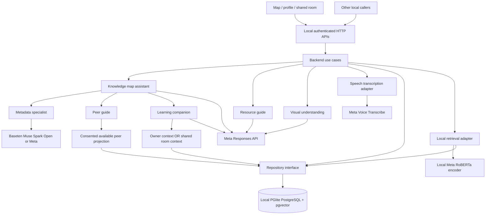
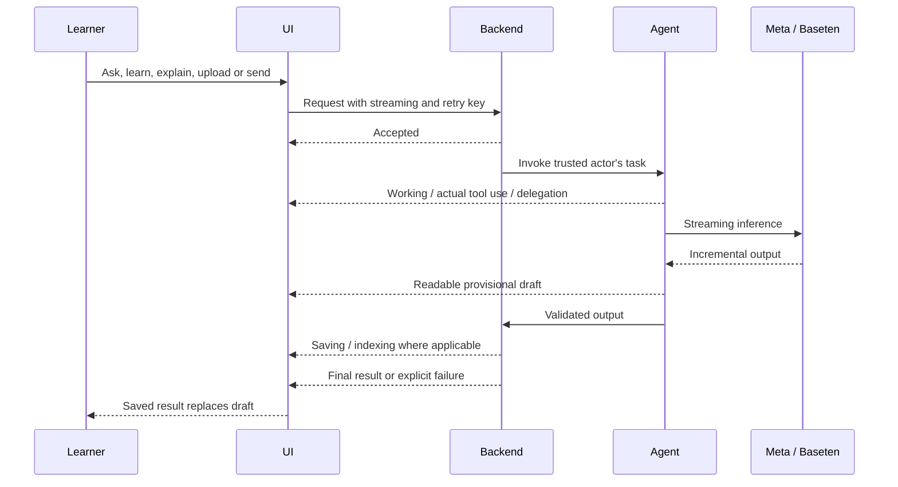

# Further: how the local system fits together

Working baseline: the latest merged Connor/Sirpreet implementation on `feature/siri-ui/iteration-nov1`, commit `15528f3`. Development stays uncommitted on local `feature/agentic-local` in `further-final`.

Further starts with a person's question and builds a useful learning map. A learner can explore alone, ask for sources, or choose to meet someone available around a shared concept. The same learning companion helps during solo work and in a shared room. People remain responsible for explaining and reasoning.

## The six domains

| Domain | Responsibility | Main entry point |
|---|---|---|
| UI | Map, learning moments, profile, invitations, shared room | `app/`, `components/`, `lib/client/` |
| Backend | Identity, validation, authorization, retries, saved state | `domains/backend/`, `app/api/` |
| Data model | Canonical concepts, personal overlay, consent, sessions and evidence | `domains/data/contracts.ts`, `domains/data/migrations/001_local.sql` |
| Agents | Independent specialists and their collaboration | `domains/agents/contracts.ts`, `runtime.ts` |
| Retrieval | Local embedding generation and private vector search | `domains/retrieval/` |
| Verification/docs | Tests, dependency inventory, decisions and live architecture view | `tests/`, `docs/`, `/architecture` |

The arrows mean actual imports or runtime calls, not proposed independent deployments. This is one modular Next.js server plus one local embedding process. Each domain has explicit contracts so it can evolve independently; it is not yet a distributed service architecture.

## Data first: facts, interpretations, and indexes

**Canonical concepts and relationships** are the shared vocabulary: a GPU, matrix multiplication, a prerequisite, or a related topic. **The personal overlay** records what one learner chose, opened, watched, explained and did with another learner. These are separate from the topic itself.

**Inferred metadata** is a correctable proposal with model/run provenance, uncertainty and `confirmed:false`. It does not silently replace a person's age, language, background, consent or available time. The current explicit question can update current intent. Heuristic progress is evidence of activity; it is not a validated measure of mastery.

**Matching projection** exposes only consented display name, active concept IDs, rough progress, language, time fit and fresh availability. It excludes private background, raw intent, raw events, media, preferences and inferred metadata. Adult confirmation, matching opt-in, language, time, presence expiry, blocks, decline cooldown and room occupancy remain exact checks. Vectors never bypass them.

**Embeddings** index concept descriptions and current intent for the owner. The schema also supports resource chunks and selected metadata, but those are not automatically indexed yet. Raw images/audio stay in local files; inferred text is separately attributed. Credentials, identity fields, moderation reports, raw private profiles and hidden model reasoning are not embedding inputs.

The complete ER diagram, constraints and repository surface are in [the data guide](data/README.md). Encoder limits and evaluation are in [the retrieval guide](retrieval/README.md).

## Independently callable agents

`GET /api/agents` exposes the current registry and input/output JSON schemas. `POST /api/agents/{agentId}` accepts `{ "input": {...}, "idempotencyKey": "unique-attempt" }`. The backend attaches the trusted actor. The same `invokeAgent` use case is called by product routes; the runtime delegates through typed tools. A model never supplies authority.

| Specialist | What it does | Current route |
|---|---|---|
| Knowledge map | Reads the private map, calls metadata, proposes concepts, optionally delegates peer/learning work | Meta Spark 1.3; optional Wonder 1.0 configuration |
| Metadata | Extracts intent, goals, concepts and uncertainty | Baseten exact hackathon Muse Spark Open when configured; otherwise explicit Meta routing |
| Peer guide | Returns and explains eligible candidates | Deterministic local matching; no fictional peers or paid call required |
| Learning companion | Solo teaching, explain-back, short course, shared facilitation | Meta Spark 1.3 |
| Resource guide | Returns provider-cited learning sources | Meta search grounding; no invented fallback links |
| Perception | Interprets an uploaded image into a proposed learning question | Meta Spark image understanding |

Transcription is an adapter, not a pretend reasoning agent: mono 16-bit PCM WAV at 16/24kHz goes to Meta Voice Transcribe. The learner confirms image-derived intent before growing the map. Muse Image generation, SAM segmentation and speech synthesis are not implemented. Meta's documented voice model is transcription, not TTS.

See [agent protocol and tradeoffs](agents/PROTOCOL.md). This interface is **Further HTTP JSON v1**, not a claim of A2A or MCP compliance. The old demo MCP fixed token and shared inbox were retired. A standards adapter can wrap these same contracts later, after authentication and interoperability testing.

## How one question travels

1. The signed local identity calls the map endpoint with a retry key.
2. The map assistant reads only that learner's map and delegates metadata extraction.
3. Model outputs are validated. Exact canonical title reuse reduces duplicates; fuzzy embedding scores never auto-merge concepts.
4. Backend saves graph membership and seed evidence once, records unconfirmed metadata and model provenance, then indexes the derived text locally.
5. The UI receives saved nodes and reloads authoritative state. If indexing is unavailable, the graph stays saved and an explicit warning allows reindexing.
6. Peer recommendations use actual opt-in local personas. Both participants must accept the same invitation before a room exists.
7. Human messages are saved before facilitator generation. A facilitator failure does not lose the person's message. Shared facilitation never receives private learner context.
8. Ending a room is idempotent. Only a room in which both humans contributed grants one participation event each; empty, one-sided and blocked rooms grant none. A separate explain-back produces model feedback with provenance.

## Live progress in every AI experience

The UI requests `Accept: text/event-stream` for AI actions. The backend sends an immediate accepted event, forwards actual runtime activity and provider text, and finishes with one validated result or a safe error. A keepalive only keeps the connection open; it is not presented as model progress.

Activity is visible alongside the experience, with the active specialist, elapsed time, cancellation and retry. This is an execution summary, not the model's private chain of thought. Raw prompts, tool arguments, reasoning and encrypted replay items remain off the public stream. A repaired model attempt clears its earlier draft; an interrupted stream cannot turn provisional text into saved learning evidence. Restoring a completed request reports that it was restored instead of replaying fictional generation.

Meta Responses and Baseten Chat Completions use actual provider streaming through the OpenAI SDK. Audio is captured locally, uploaded as supported PCM WAV, then transcribed through Meta's HTTP event stream. Transcription partials replace the previous hypothesis; live microphone-to-WebSocket transcription remains a separate future enhancement. Deterministic peer matching and ordinary database operations show real waiting/completion states rather than fabricated text tokens.

## What scales next, and what does not yet

Implemented seams: repository interface, typed agent ports, provider adapter, bounded tools/context/cancellation, durable run records, owner-scoped vectors, separate media files and idempotent operations.

The current database is PGlite: local PostgreSQL in a single process with pgvector. Its directory lock deliberately prevents multiple independent app workers. A native PostgreSQL adapter, connection pooling, migrations under deployment, production identity/OAuth, object storage, background job queues, transactional outbox, vector ANN indexing, distributed presence and server push for room/presence updates remain future work. AI requests stream over SSE; social state still uses HTTP polling. This is not a scale benchmark. Current local persona switching is a development tool, not access control for a multi-tenant deployment.

The encoder is a pinned Meta RoBERTa masked-language model with mean pooling. It provides an executable local baseline, not a retrieval-trained production model. Measure recall with project queries before changing match rules. Vector search currently scans a small owner-scoped corpus; add an evaluated index only when needed.

No automated content classifier or staffed report-handling workflow is configured. Persistent block/report and bounded room writes exist; a stored report is not a reviewed report.

## Keeping the map current

- `/architecture` reads the shared agent registry, current migration table names and safe configuration/health.
- `npm run map` regenerates [dependency-map.json](dependency-map.json) from TypeScript imports, including type-only edges.
- Update this guide and domain docs whenever behavior changes. Keep implementation, fixture tests and live-provider evidence separate.
- Every domain has its own `AGENTS.md`; the workspace file opens domains side by side. New contracts are agreed before parallel edits.

## Documentation used

Reviewed November 1, 2026: [Meta models](https://dev.meta.ai/docs/models), [Meta Responses](https://dev.meta.ai/docs/protocols/responses), [Meta speech-to-text](https://dev.meta.ai/docs/speech-to-text), [Baseten Model APIs](https://docs.baseten.co/inference/model-apis/overview), [PGlite setup](https://pglite.dev/docs/), [PGlite extensions](https://pglite.dev/extensions/), [RoBERTa model card](https://huggingface.co/FacebookAI/roberta-base), and [OpenAI SDK/agent model integration](https://developers.openai.com/api/docs/guides/agents/models).

The core OpenAI SDK provides HTTP types and transport only. Runtime inference uses Meta/Baseten endpoints. The local orchestrator deliberately keeps Meta's encrypted reasoning replay intact without adding an external trace exporter.
