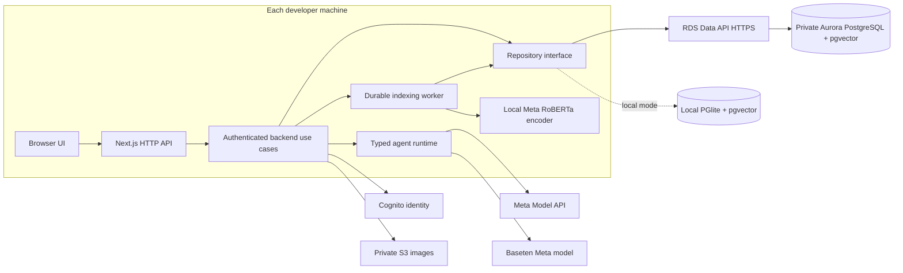
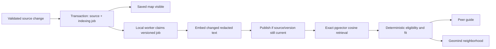

# Further architecture — v2

Further turns a rough question into a personal learning map, then helps willing, available people learn together. The workspace is a full-screen radial map with one side panel (question switcher, path or open card, progress line, composer); learning history lives on Profile. v2 adds topic navigation, semantic peer discovery and shared AWS persistence. Start with [onboarding](ONBOARDING.md); use the [code map](CODE_MAP.md) to find an implementation.

## Where it runs

| Mode | Identity | Records and vectors | Uploaded images |
|---|---|---|---|
| Default local development | Local accounts | Isolated PGlite | Private local files |
| Shared AWS development | Cognito | Aurora through Data API | Private S3 |

Both modes run the UI, APIs, agents and encoder locally. They use the same repository contract. There is no deployed application Lambda/API Gateway or cloud agent host. One Next.js process serves the agents; independent agent **interfaces** do not require separate processes or ports. The encoder is a second local process. PGlite permits one owner process per data directory.

The checksum-pinned encoder reference uses an explicit LF Git attribute so Windows checkout conversion cannot alter its embedding-space identity.

The build reapplies `next.config.ts`'s private-runtime trace exclusions with normalized separators before running the independent privacy validator. This handles Next 15's Windows glob-matching behavior without weakening the check or removing application assets.

Two identities have different purposes: a **Cognito learner** owns application records; the **developer's temporary AWS IAM credentials** let the local backend access Data API and S3. Backend authorization must scope every operation to the learner. The browser receives neither AWS credentials nor model keys. Existing PGlite users/history are not automatically copied or linked to Cognito by email.

The shared development deployment has Cognito email/password signup and Facebook federation enabled. Facebook's app remains in Development mode, limiting Facebook sign-in to eligible app-role users. Google remains parked. Deployment receipts and configuration are in [AWS deployment](AWS_DEPLOYMENT.md); identity rules are in [authentication](AUTHENTICATION.md).

## Facts, interpretation and derived data

| Layer | Stored as | Meaning |
|---|---|---|
| Shared concept vocabulary | `concepts`, `concept_edges` | Canonical concepts and `related`, `prerequisite`, `part_of` relationships |
| Personal learning history | `learner_concepts`, `learning_events`, `learners`, `profile_revisions` | Membership, activity, explicit intent, preferences and consent |
| Model interpretation | `inferred_metadata`, `agent_runs` | Correctable proposals, provenance, uncertainty and validated outputs |
| Rebuildable search | `retrieval_index_jobs`, `retrieval_vectors` | Changed text, durable work and versioned 768-dimensional vectors |
| Shared interaction | `presence`, `invitations`, `learning_sessions`, members/messages, blocks/reports | Availability, mutual consent, room history and safety boundaries |

The repository applies migrations **001–006** in order in either database mode. Migration versions are parsed from the platform-native filename, so Windows paths do not cause later migrations to be mistaken for version 001. See [data schemas and ER diagram](data/README.md) and the [migration map](CODE_MAP.md#schema-and-storage-entry-points).

Profile offers a confirmed reset through `POST /api/data/reset`. One actor-scoped transaction removes private map membership, learning events, generated metadata/runs (including saved questions and summaries), and non-intent search jobs/vectors. Account/profile data, the profile goal's intent index, uploaded images, shared conversations, and safety records remain. Active guides, live rooms, and unexpired invitations block reset. Durable reset receipts make a repeated request a no-op even after new learning; stale indexing leases cannot republish removed concepts. Success hard-navigates to the empty workspace and notifies other browser tabs to reload.

“My knowledge map” is a private derived hierarchy over saved canonical concepts. The knowledge-map agent summarizes topics/subtopics; the backend validates exact membership and caches by owner, graph content, prompt version and inference mode. Summary nodes do not become new concept identities, evidence or matching permissions. Durable `part_of` edges run **parent → child**; multiple parents are allowed, cycles rejected. Breadcrumbs provide semantic zoom; viewport zoom only changes drawing scale. Large maps use bounded batches and nested summaries rather than silently omitting concepts. See [semantic zoom](GEOMIND.md#topic-overview-and-semantic-zoom).

Inferred metadata remains unconfirmed; it cannot silently change age, sharing consent or profile facts. Activity and AI-reviewed explain-back scores are learning evidence, not verified competence. Shared-room facilitation receives shared context, never either participant's private map.

Concept and overview-topic nodes show anonymous unique-learner completion counts. A concept requires a saved live 3/3 AI-reviewed explain-back; a grouped topic requires the same learner to have explained every member concept. Repeated attempts/retries count once. The authenticated completion endpoint accepts only concepts owned by the viewer and returns totals, never learner identities or assessment text. Counts are derived from existing events with the shared progress logic and a partial explanation index, so existing history works without a backfill and reset removes the learner's contribution. Counter loading/polling is separate from map generation and summary caches; sample data and fixture grades cannot produce completions.

## Saving, indexing and discovering peers

Hashes skip unchanged work; leases, retries and stale-result checks prevent duplicate edits from producing stale search results. Saved, indexing, retrying and searchable are separate UI states. Jobs survive restarts in either store; processing pauses when no local worker is running.

Owner search can index concept descriptions, explicit intent and selected redacted inferred learning metadata. **Peer retrieval uses only consented active concept vectors**, not another person's intent, background or full map. Semantic retrieval can connect differently named concepts. Exact age/consent, language, available time, fresh presence, blocks, cooldown and occupancy checks still apply. A shared deterministic function powers peer guide and Geomind; no LLM ranks people. Evidence and time fit supplement similarity, which does not establish expertise.

Geomind displays at most 24 available peers, with conceptual similarity controlling radius. Angular placement is illustrative, not a global coordinate or physical location. Opening it sends no invitation; an explicit invitation rechecks eligibility. Different paired concept IDs remain attached through the room and completion. See [Geomind behavior and limits](GEOMIND.md).

The Geomind UI loads its neighborhood on view entry and refreshes only on explicit Refresh/retry actions. It does not poll or reload on focus, profile/activity changes or invitation outcomes. Successful empty neighborhoods leave the map unobstructed; operational and consent notices remain. Displayed peers can become stale between refreshes, so invitation eligibility is still rechecked server-side.

The local encoder is pinned `FacebookAI/roberta-base`, masked-mean pooled, centered using a frozen reference artifact and normalized. Its space revision includes that artifact; incompatible versions are never compared. This is an **experimental feature encoder**, not a retrieval-trained production model. Missing/stale vectors produce explicit states, never a keyword fallback. See [retrieval and evaluation](retrieval/README.md).

Short owner-search queries can reuse bounded current concept descriptions when they match an owned title/slug or the original question of a saved live map. Unrelated profile intent and private metadata are not appended, and no additional model call is made. This changes query representation only: stored vectors, the encoder revision, consented peer targets and eligibility remain unchanged.

## Agents and live progress

| Agent ID | Responsibility | Live inference |
|---|---|---|
| `knowledge-map` | Expand, plan, recommend; summarize the saved map | Direct Meta Spark 1.3 by default; optional configured Wonder 1.0 |
| `metadata` | Propose intent, goals, concepts and uncertainty | Explicit Meta route, or Baseten `meta-models/muse-spark-open-1026` |
| `peer-guide` | Explain eligible semantic candidates | Deterministic backend matching; no model call |
| `learning-companion` | Solo lesson/course, explain-back, shared facilitation | Direct Meta Spark 1.3 by default |
| `resource-guide` | Find provider-cited sources | Direct Meta with web-search grounding |
| `perception` | Turn an image into a proposed question | Direct Meta image understanding |

The OpenAI SDK supplies transport/types to approved Meta/Baseten endpoints. The local runtime is not the OpenAI Agents SDK. All product inference is Meta-only; provider failures remain failures, with no silent fixture or provider fallback. Transcription is a separate Meta Voice Transcribe adapter; speech synthesis and image generation are not implemented.

Mandatory map reads and expansion metadata delegation run before the first knowledge-map model turn, using the existing shared budgets, cancellation, actor-scoped ports and real progress events. Validated results are supplied as untrusted prepared context. Ordinary expansion therefore needs two model calls rather than four sequential calls; a bounded topic summary or plan needs one. Optional tools and one bounded repair remain available; provider latency is not hidden with simulated progress.

Every specialist is independently callable through authenticated HTTP and the same `invokeAgent` use case. Model-selected delegation shares actor, correlation, cancellation and budgets; a request need not call every specialist. This is **Further HTTP JSON v1**, not certified A2A or MCP. See [agent protocol](agents/PROTOCOL.md).

AI routes use SSE: immediate acceptance, persona-labeled activity/tool/delegation events, real provider text, then a validated result or safe failure. Draft text is provisional; it becomes evidence only after validation and saving. Cancellation propagates to inference. Restored results are labeled as restored. The public stream excludes prompts, raw tool arguments, private reasoning and encrypted replay items. Room/presence updates still poll HTTP. See the [stream contract](CODE_MAP.md#agent-and-stream-contracts).

## Boundaries for the next developer

- Keep the current UI composition and typed domain boundaries. Change contracts before changing their callers.
- Exact vector search and candidate-history replay are current implementations, not ANN or a population-scale benchmark. Materialized candidate projections and hosted workers remain future work.
- Reports are persisted; no staffed moderation workflow is configured. Room participation is credited only when both humans contributed, once per completion.
- [Verification](VERIFICATION.md) separates automated, browser and live-provider checks. Configuration alone is not a successful cloud/model round trip.
- `/architecture` reads the registry/schema/configuration; `npm run map` refreshes the [import dependency inventory](dependency-map.json). Update these docs when behavior changes.

For provider work, consult current official [Meta model](https://dev.meta.ai/docs/models) and [Responses](https://dev.meta.ai/docs/protocols/responses) documentation first; details and reviewed references live in the domain guides.
