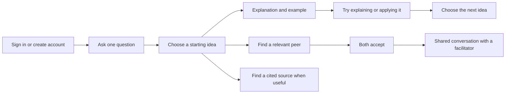

# Further: refine the established map experience

The v1 snapshot is preserved on `feature/v1` at `fadcef7`. The current v2 handoff is on `feature/v2` in `further-final` and `feature/mani-v2` in `further`. The user rejected an earlier replacement layout and reaffirmed the v1 composition on November 1; this milestone preserves it. Improvements should simplify that composition. Persona-labelled live activity is explicitly preferred. Google OAuth is parked.

## The learner's route

The question is the organising unit for a learning session. It owns a view of a small set of concepts, not a separate copy of those concepts. Two questions can share a concept and its learning evidence. Starting an unrelated question saves another focus inside the same v1 workspace. The journey pane stays on the left, the map in the centre, the inspector on the right and the composer below. Three compact canvas controls distinguish **This question**, **My knowledge map** and **Geomind**. The saved-question selector and the journey’s **Questions** section switch between questions. The focused hub labels the question; My knowledge map restores the learner hub and all saved topics, including older learning. Learning and peer discovery remain intentional actions.

Geomind is the social view of conceptual neighborhoods: people become relevant through shared ideas, current interest and what each can contribute. Its first local implementation shows real eligible people available now, using the existing matching opt-in. Selecting someone explains the shared topics, and a deliberate invitation still requires both people to accept. It does not publish private learning history, invent a crowd or treat conceptual positions as geographic distance. Persistent community membership and optional physical region are separate future choices; see [Geomind](GEOMIND.md).

My knowledge map now starts with summarized topics across all saved questions. It does not display every question path at once. Clicking a topic zooms into its member concepts; clicking a concept opens its lesson. A breadcrumb and zoom-out return to the broader overview. The same canonical concepts remain underneath for peer matching and saved evidence. Topic organization uses a cached Meta-generated proposal with complete membership validation; opening an unchanged map restores that proposal without a new inference call.

## Progress means evidence

Reading and participation are recorded as activity. They do not establish mastery. A best AI-reviewed explanation score is retained internally for continuity, but the learner sees **Not started**, **Exploring**, or **Explained**. Repeated partial answers do not accumulate into a completed explanation. “Explained” means a submitted explanation received full model feedback; it is not independent proof of competence.

The next step uses actual evidence: after a successful explanation, move to an application or another concept. After partial feedback, try a concrete example and revisit the explanation. Inactivity does not prove forgetting. Format preferences inferred from clicks are tentative, editable hints, not fixed learning styles.

## A helpful guide without a second dashboard

The guide can read the current map, propose a next step, and delegate to specialists. Asking for a plan saves the agent run, but does not automatically add another path or overwrite the goal. Explicit exploration is the action that changes the map. Lessons build on the learner's prior saved lesson and include a mechanism, example and a question to apply the idea. Sources are requested when needed, carry actual provider citations, and separately report link reachability.

Every AI wait shows what is happening and supports stopping the request. Actual response text streams into the primary reading surface. Details reveal agent handoffs and tool activity; no private reasoning is exposed. Drafts remain provisional until validation and persistence finish. A retry retains the intended mutation's identity, avoiding duplicate completed paths or paid calls when a response was interrupted.

Reopening a saved lesson restores the owner's exact topic/depth lesson without new inference. A new example or explicit replacement requests new work; its practice belongs to that lesson, not its predecessor. Fixture lessons never become context for live lessons. When a request definitely failed before saving, the server permits a fresh attempt; an unknown or partially saved outcome keeps its old key so retry cannot silently repeat a mutation.

Peer search uses the current question's topics. The server checks that every requested topic belongs to the learner's saved map, then applies real consent, presence, language and time constraints. Switching paths does not discard an existing invitation or shared room.

## Real accounts, local data

Accounts replace the development persona chooser in normal use. Signup saves username, display name and credentials locally; Google sign-in is parked; its dormant implementation uses only basic identity scopes when configured. Real accounts cannot be selected through the synthetic-profile API. Prior v1 test data remains intact and separate. App data stays on the Mac; Google authentication and the explicitly selected Meta/Baseten inference calls use their hosted services.

See [Authentication](AUTHENTICATION.md) for Google setup and verification limits, [Architecture](ARCHITECTURE.md) for system boundaries, and [Verification](VERIFICATION.md) for measured results.

## Review criteria

- A new learner can identify one clear starting action.
- Starting a second, unrelated question does not mix the visible paths.
- Reload restores the account, question history and evidence.
- My knowledge map brings all saved learning together without replacing the current question or losing its evidence.
- Geomind explains conceptual relevance using real eligible learners; opt-out, stale presence and blocks remove eligibility, including on invitation revalidation.
- The overall composition remains recognisably v1; simplification uses disclosure and quieter copy within its existing surfaces.
- Persona-labelled streaming is visible without turning the lesson into a diagnostic console.
- A source failure or no available peer is honest and recoverable.
- One account cannot load another account's private map or room.
- Participation is never presented as verified understanding.

These criteria guide the local browser review. Real learner usability and learning outcomes still need observation beyond developer testing.

## Nested map acceptance

My knowledge map supports a topic → subtopic → concept navigation stack. Breadcrumbs and semantic zoom-out move between levels; the central node describes the current container. Saved parent-to-child relationships can be explored repeatedly, including a concept with more than one parent, while its lesson and learning evidence retain one canonical identity. Summary nodes remain private organization, not invented learning records or peer-matching IDs.

Subtopic generation is explicit about waiting, provisional drafts and errors. It checks durable scoped summaries first, and it never presents the same membership as an endlessly repeated child level. More than twelve siblings use progressive paging. Maps larger than one model context use bounded grouping and reduction, preserve all concept membership, and keep the original graph intact. Browser review should check a three-level part-of chain, a cross-question shared parent, multiple-parent navigation, return via breadcrumbs/zoom/Escape, a failed branch summary with concepts still accessible, and a large-map cache restored after a database restart.
