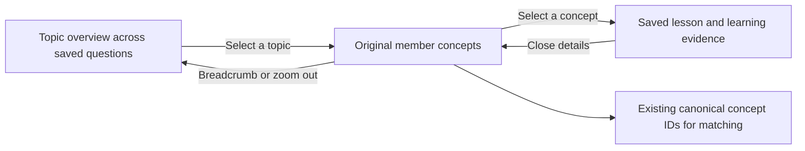
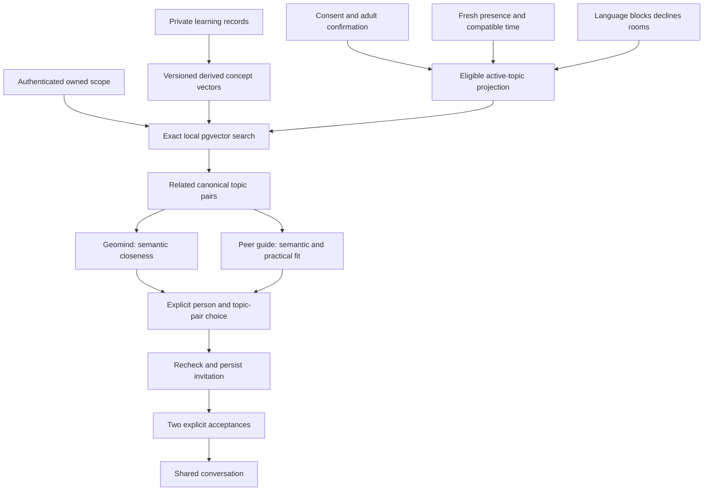

# My knowledge map and Geomind

Further has two connected maps. **My knowledge map** holds what one person has explored across their saved questions. **Geomind** helps that person find other learners around shared ideas. Starting a new question changes the focus; it does not replace the learning history.

The current implementation keeps the v1 journey, central canvas, inspector and bottom composer. Three views within that canvas make the distinction visible:

| View | What it answers | What it shows |
|---|---|---|
| This question | What am I working on now? | The selected saved question and its concepts. |
| My knowledge map | How does everything I have explored connect? | Summarized topics across questions; zoom into a topic to see its original concepts, relationships and accumulated evidence. |
| Geomind | Who could explore nearby ideas with me now? | Real, eligible learners who currently share topics and are available for a conversation. |

One concept can belong to several questions while retaining one personal evidence history. The full map represents learning recorded in Further, not an assessment of everything a person knows. **Explored**, a partial explanation and **Explained** are different states. Explained means a full AI-reviewed explain-back; it is not independently verified competence. A large map or frequent activity is not a higher intelligence score.

### Topic overview and semantic zoom

My knowledge map begins with a small set of topic summaries, not every step from every saved question. The Meta knowledge-map specialist proposes groups from the owner's canonical concept titles, hooks and relationships. A group can span several questions. The server checks exact coverage: every saved concept belongs to one primary group, no concept is invented or omitted, and IDs remain the original matching IDs. The overview is a presentation proposal, not a change to canonical concepts or a new measure of knowledge.

Clicking a topic zooms into its constituent concepts and their recorded relationships. Clicking a concept opens the existing lesson inspector. The breadcrumb, back control and zoom-out return to the topic overview. Summary nodes show counts rather than synthetic mastery states. Question history remains in This question and the journey rail.

The derived summary is private and cached by owner, graph content hash, prompt version and inference mode. Reopening an unchanged map reuses the saved result; ordinary learning events do not regenerate the grouping. Changing concepts or relationships invalidates it. Live summary generation streams actual Meta activity and text; only the validated result becomes the overview. Summarization does not alter current intent, learning events, sharing choices or peer scores. Large maps beyond the current complete-snapshot budget produce an explicit limit rather than silently summarizing a truncated subset.

## Conceptual neighborhood

Geomind and the peer-guide now use one `semanticPeerSearch` backend. It retrieves topic pairs with exact pgvector cosine distance, including pairs whose canonical IDs and wording differ. It does not ask an LLM to choose people. Each learner keeps several concept vectors rather than one averaged whole-profile vector. IDs still identify records; similarity never merges concepts or transfers learning evidence.

The current local encoder is a pinned Meta RoBERTa feature extractor followed by subtraction of a frozen, neutral reference mean and normalization. That transform has its own revision and content hash; it is independent of current learners and discovery candidates. Cosine scores remain **experimental retrieval signals, not probabilities, intelligence scores or proven learning fit**. The operating point belongs to the exact model/revision in `semanticOperatingPoint`; unknown spaces fail visibly. A builder can override the minimum only alongside the exact current embedding revision. Changing an encoder requires reindexing and evaluation, not copying the old threshold.

The shared engine performs these steps:

1. Validate the authenticated learner's selected concepts. An explicit older question can recall its concepts; otherwise use up to five active concepts.
2. Read eligible peers through the consent, adult-confirmation, language, time, presence, blocks, recent-decline and room/invitation guards.
3. Search owner concept vectors against only those peers' currently shared active concept vectors, in the same model/revision and current content hash. No private peer intent, metadata, background, media or unrelated vectors are search targets.
4. Keep topic pairs above the space-specific operating point and group them by person. Within each person's results, advertise at most three pairs whose similarity is at least `max(minSimilarity, bestSimilarity - 0.10)`, with stable canonical-ID tie-breaking. This experimental relative band reduces weak cross-topic clutter; it is a generic mathematical rule, independent of names or topic keywords. A person's closest retained pair supplies conceptual proximity; unrelated interests are not averaged into that closeness.
5. Compute recommendation fit with explicit rules: `0.85 × semantic similarity + 0.10 × reviewed-explanation evidence + 0.05 × available-time fit`. These are prototype policy weights, not a calibrated success probability. Reviewed evidence indicates a possible discussion resource; missing evidence does not establish low knowledge or teaching ability.

**Geomind placement uses semantic proximity only.** Available time and reviewed evidence affect the recommendation score, not where someone's mind appears. Neighbors are sorted by semantic similarity with stable ID tie-breaking. Peer guide and the direct matching action use the same candidates and recommendation components. Selecting a person never creates an invitation.

If vectors are pending or unavailable, the response reports that state. There is no silent keyword-overlap fallback and no fabricated people. The explicit UI sample mode retains its separately labelled historical scoring helper; it is not the local account/data path.

Partial index coverage remains visible, but it does not block an already indexed, source-current pair. A targeted invitation recomputes and validates that exact pair; an unrelated learner's pending index cannot prevent two ready learners from connecting. A requested pair without usable vectors still fails visibly.

## Five pieces of state

| State | Meaning | Current boundary |
|---|---|---|
| Durable learning evidence | Saved concepts, questions, explain-backs, feedback and session activity | Private to the learner; model/run provenance remains attached. |
| Current intent | What the learner wants to explore now | Separate from accumulated knowledge and lasting profile fields. |
| Discovery projection | The limited information used to find a peer | Matching opt-in permits the existing available-now projection, not publication of the whole map. |
| Presence | Whether someone is available for a live conversation | A short-lived heartbeat plus room occupancy checks. |
| Physical location | A possible future coarse location preference | Not collected or used by this feature. |

The internal eligible-peer projection includes display name and opaque ID, up to five active concepts with explanation-progress values, language and time availability. The public Geomind result narrows this to related topic pairs, common available minutes, raw semantic similarity and qualitative reasons. It never returns vectors, raw explanation scores or unrelated parts of a map. It excludes raw current-intent text, private background, preferences, event payloads, media and inferred metadata.

Eligibility requires adult confirmation, compatible language, fresh presence, at least ten minutes in common, no mutual block or recent decline, and no active room. Incompatible pending invitations also remove people. For an existing cross-concept invitation, each participant's own reserved topic remains the projection. Time, consent, presence, membership and blocks are checked again inside invitation creation and acceptance transactions.

Matching opt-in is not an offline community membership switch. A future persistent community would need explicit sharing choices: which concepts to publish, whether an offline profile is visible, and what others can read. Whole-map sharing, persistent public profiles and inferred location are not part of this increment.

## Current request and dependency flow

`POST /api/geomind` accepts `{ conceptSlugs?: string[] }`. A supplied scope must contain 1–100 owned canonical concepts; discovery compares the five most active within that scope. The private knowledge map remains independent of this bounded currently shared projection.

The response keeps `mode: "available-now"`, at most 24 neighbors and `hasMore`. Each neighbor contains:

- `sharedTopics`: the owner's relevant canonical topics, retained for older local callers.
- `topicPairs`: authorized `{ ownTopic, peerTopic, similarity }` pairs, including different concept IDs.
- `proximity`: `method: "semantic-cosine-v1"` and raw `similarity`; deprecated `overlap` repeats that value for compatibility.
- `recommendationScore`: the separate practical/evidence fit score.
- `reasons`: shared-topic, related-topic and reviewed-explanation reasons, without raw grades.

The index descriptor reports the exact model/revision, current query coverage, experimental calibration and readiness. `emptyReason` distinguishes discovery disabled, adult confirmation, no topics, no nearby result, indexing and index unavailable. A no-neighbor result is not proof that the broader population has no related people.

The UI checks the neighborhood once when Geomind opens and subsequently only through Refresh or an explicit retry button. There is no discovery polling, focus/visibility refresh, profile/activity-triggered reload or automatic reload after invitation outcomes. A successful no-neighbor response leaves the map clear of an empty-state card; loading, errors, consent and indexing notices remain. The displayed neighborhood is a snapshot until manually refreshed. Invitations still recheck authoritative eligibility on the server.

`POST /api/geomind/invite` accepts `{ peerId, conceptSlug, peerConceptSlug? }`. The optional peer concept identifies a specific cross-concept pair; the server recomputes eligible semantic candidates and never accepts client scores or a substitute person. The saved invitation stores both canonical topics and encoder provenance. Exact retries and reciprocal requests reuse the existing invitation. Both learners must explicitly accept before a room opens. Each participant's view and completion evidence reference their own concept, so the receiver is not silently enrolled in the sender's concept.

Invitation rechecks use the bounded current topic neighborhood (including an older explicitly chosen owner topic where needed), retaining the same relative-band policy. Isolating an otherwise rejected weak pair in the request cannot promote it into an advertised connection. Readiness is still assessed for the selected fresh pair, so an unrelated learner's pending indexing does not block a valid invitation.

The peer-guide tool can pass a typed query to `rankedPeers`. The local encoder first recalls relevant concepts from the owner's saved map, then the same eligible semantic engine retrieves peers. It does not publish that query or make it a peer search target. Missing search/index capability is a visible error.

The repository remains the authority for visibility; an agent explanation cannot override consent. Meta's [tool-calling documentation](https://dev.meta.ai/docs/tool-calling) leaves developer-defined tool execution in application code. Geomind itself makes no generative model call and shows genuine loading/results/errors. AI teaching and map flows retain real persona-labelled provider streaming.

## Local limits and evaluation

`listCandidates` still scans eligible learners and replays their histories in the selected database. Vector search is exact over the authorized projection and has a bounded per-concept result budget. The 24-person UI limit is not a measured population capacity claim. Shared AWS storage is deployed; application compute and indexing workers remain local. One PGlite process owns each local-mode database. Distributed application hosting remains parked.

Synthetic unit vectors test database math, consent, ownership, source versioning and deterministic behavior. They do not establish encoder quality. The real-encoder evaluation source in `domains/retrieval/evaluation.json` and the separately recorded fixed-reference-centered probes describe measured strengths and failures. The 8-query smoke set and independent 10-query holdout each ranked their hand-labelled target first. At the provisional discovery floor of `0.55`, 15 of those 18 targets remain; 9 of the 36 reported non-target top-three entries also remain. This is a small, selected retrieval evaluation, not a population false-positive rate or proof of peer fit. The broader harder probe still has retrieval mistakes. Users should see the actual paired topics instead of a confidence percentage or an unqualified claim of conceptual accuracy. FAIR documents RoBERTa's [feature extraction and downstream task adaptation](https://github.com/facebookresearch/fairseq/blob/main/examples/roberta/README.md).

If approximate indexes become necessary, evaluate their recall/latency tradeoff separately from policy filters. [pgvector](https://github.com/pgvector/pgvector) distinguishes exact and approximate search; neither establishes permission, expertise or useful interaction. Low-confidence retrieval should be evaluated against an explicit abstention policy before broad deployment.

Offline community sharing and physical geography remain separate future consent and product decisions. Neither is collected or inferred here.

See [architecture](ARCHITECTURE.md), [data ownership](data/README.md) and [retrieval limits](retrieval/README.md).
