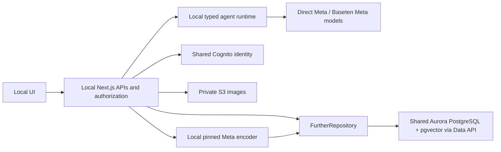

# v2 development handoff

Read this file when continuing the branch or giving the repository to a coding agent. Start with [onboarding](ONBOARDING.md) for execution and [AGENTS.md](../AGENTS.md) for engineering constraints.

## Snapshot and source of truth

The team works from `feature/mani-v2` in `manpinder-png/further`; the matching delivery snapshot is `feature/v2` in `manpinder-png/further-final`. Continue the team branch with normal reviewed feature work. Neither publication merges to `main`; future integration into the delivery repository is a separate step.

This milestone retains the v1 map-centred UI. It does not resurrect the discarded alternative layout. Its HTTP agent protocol is still **Further HTTP JSON v1**.

Use this reading order:

1. `AGENTS.md`, this handoff and `README.md` — constraints and current scope.
2. [Architecture](ARCHITECTURE.md) — components, dependency and streaming diagrams.
3. Relevant domain guide: [UI](ui/README.md), [backend](../domains/backend/AGENTS.md), [data](data/README.md), [agents](agents/README.md), [retrieval](retrieval/README.md).
4. Actual contracts and source files below; [verification](VERIFICATION.md) distinguishes real-provider, fixture and unverified behavior.

Older `DESIGN.md`, discussion slides and business-requirement drafts preserve earlier proposals. They do not override the implemented contracts or later user decisions.

## System map

Default local mode substitutes PGlite/local accounts/local images. The same repository and migrations serve both modes. AWS hosts data and identity; application/agent compute remains on developers' machines. See the architecture guide for the full alternatives and ER diagram.

| Work area | Start in | Contract to preserve |
|---|---|---|
| Question, knowledge map, Geomind, lesson and room UX | `app/`, `components/`, `lib/client/` | Preserve the v1 layout; render server facts and real streamed progress |
| Identity, authorization, persistence use cases | `domains/backend/`, `app/api/` | Derive the actor from a verified session; client/model actor IDs never grant authority |
| SQL and canonical learning records | `domains/data/contracts.ts`, `repository.ts`, `auth-store.ts`, `migrations/` | Add ordered migrations; use the SQL port and typed UUID/JSON parameters |
| AWS/PGlite transport | `domains/data/aurora-data-api.ts`, `sql.ts` | Transaction semantics, bounded responses, explicit safe retries and no unknown-outcome replay |
| Agents and model routing | `domains/agents/contracts.ts`, `runtime.ts`, `openai-provider.ts` | Typed inputs/outputs, bounded tools, cancellation, provenance and Meta-only inference |
| Embeddings, durable indexing and semantic matching | `domains/retrieval/`, `lib/matching.ts`, `lib/geomind.ts` | Exact embedding-space/version compatibility; eligibility before deterministic ranking |
| Auth and private images | `domains/backend/cognito-*.ts`, `auth.ts`, `media-storage.ts` | Verified subject identity, owner-only access and server-side credentials |
| AWS infrastructure | `infra/aws/` | Validate source and inspect a change set; keep existing data protected |

`npm run map` regenerates [dependency-map.json](dependency-map.json) from imports. `/architecture` combines the agent registry, migrations and safe configuration. A configuration flag is not a live connectivity receipt.

## Data and behavior that matter

A learner owns a private overlay over canonical concepts and edges: chosen questions, activity, evidence, preferences and current intent. Summarized topics are an owner-scoped derived navigation view; they preserve member IDs and do not become new matching identities or evidence of mastery. Durable `part_of` links support nested concepts and multiple parents; cycles are rejected.

Changed source text atomically enqueues indexing work. The local encoder builds versioned vectors; jobs use hashes, leases and retry/recovery. Saving a map and becoming searchable are distinct states. Jobs remain durable when developers go offline, but processing pauses without a local worker.

Geomind and peer recommendations share semantic retrieval plus fixed eligibility/ranking. They expose only active, consented candidate topics and permitted fit signals. Private maps, raw intent, background, inferred metadata, media and hidden model reasoning are excluded from peer projections. A model's interpretation or vector similarity never grants access or silently merges concepts.

Invitations, mutual acceptance, rooms and completion are transactional and idempotent. Both people must accept before a room exists. Shared facilitation sees participant-approved room context, not private learner context. Progress is an activity heuristic; model feedback is not a validated mastery score.

## Agent interfaces and progress

The registry at `GET /api/agents` supplies schemas. `POST /api/agents/{agentId}` accepts the declared `input` and an `idempotencyKey`; the backend attaches identity. Product routes and typed internal delegation use the same agent contracts:

- `knowledge-map`: proposes learning concepts and summary navigation.
- `metadata`: infers correctable intent/metadata with provenance.
- `peer-guide`: deterministic authorized candidate discovery; no invented peers or LLM ranking.
- `learning-companion`: solo teaching, explain-back and shared facilitation.
- `resource-guide`: provider-grounded learning sources.
- `perception`: image-to-learning-question proposals.

Transcription is a dedicated Meta adapter. The orchestrator uses core OpenAI SDK transport against Meta/Baseten endpoints; it is not an OpenAI inference integration or a claim of MCP/A2A interoperability. External protocol adapters can wrap the existing contracts later.

AI routes use SSE: accepted → actual agent/tool/delegation activity and provisional text → validation/saving → one final result or safe error. Keep private reasoning, raw prompts/tool arguments and secrets out of the UI. Cancelled/failed drafts must not become saved learning evidence. Missing providers and indexes fail visibly, never as fabricated fixture successes.

## Before handing over another change

1. Reproduce the issue in the intended mode. Keep unit/HTTP fixtures out of shared AWS real-user data.
2. Change the owning domain and its contract together. Preserve existing history and identity; do not reset data to make a test pass.
3. Run `npm run check`, then `npm run build` sequentially. Stop the local app before building because it shares `.next`. Then run `python3 scripts/test-http.py` for the HTTP suites with fresh isolated fixture databases; independent semantic test populations must not interfere.
4. Run `npm run map` after import/source moves. Update the architecture/domain guide and verification evidence when behavior changes.
5. Inspect the staged diff for credentials, personal notes, environment files, local databases, model weights and logs. None belongs in Git. Publish only the explicitly requested feature branch; do not merge `main` automatically.

For provider/API changes, read current official Meta/Baseten documentation and test the exact capability. Baseten's grant uses only `meta-models/muse-spark-open-1026`. Keep product inference Meta-only. Do not assume a Meta SDK's current Graph version is accepted by Cognito; the deployed federation pin and its evidence are in [authentication](AUTHENTICATION.md).

## Limits and sensible next work

The next acceptance step is the colleague's two-machine test in [onboarding](ONBOARDING.md#6-two-person-live-test). Record its actual result before claiming multi-machine readiness on their environment.

Known boundaries: unpublished Facebook app roles, no automatic account linking/local-history import, experimental RoBERTa retrieval quality/thresholds, exact vector search and unbounded candidate-history work, polling social state, local-only indexing workers, no cloud API hosting and no measured population-scale capacity. Google OAuth, physical geography, TTS and video calling remain parked. Address these as explicit tasks rather than quietly changing current behavior during handoff.
