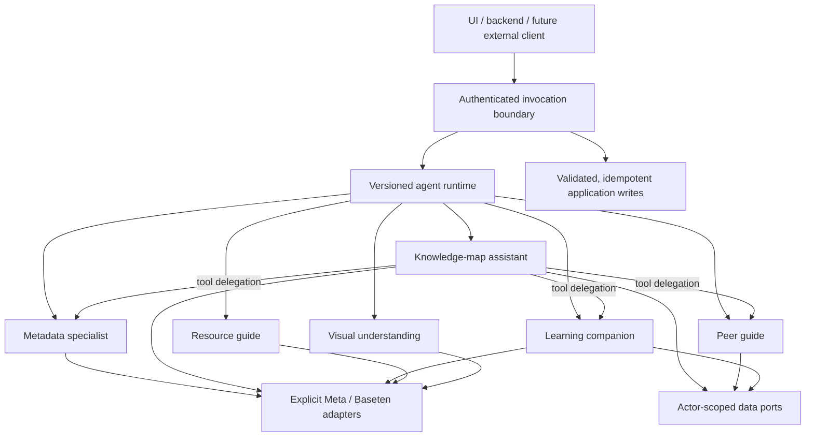

# Further agent system

This domain implements independently callable specialists and bounded collaboration. The user selected the knowledge-map and adaptive-learning direction on November 1, 2026. Agents propose changes and read through trusted ports; the backend controls identity, consent, transactions and durable storage. No agent owns a second copy of the user database.

## Specialists

| Agent ID | Responsibility | Current execution |
| --- | --- | --- |
| `knowledge-map` | Personal assistant for concept-map growth, next steps and peer discovery | A real model-controlled tool loop: read the map, delegate metadata inference, optionally ask the peer guide or learning companion, then return a validated proposal |
| `metadata` | Infer current learning intent and a limited matching projection | A bounded structured model call; unknowns remain explicit; no automatic promotion to permanent profile facts |
| `peer-guide` | Find and explain eligible people | Deterministic application policy through an injected port; no model may invent a person or override availability/consent/block filters |
| `learning-companion` | Help during solo exploration and shared learning | One specialist with `solo`, `facilitate` and `explain-back` modes; context comes from the backend |
| `resource-guide` | Find documentation, articles and videos | Meta Responses web search; returned source links must be supported by provider citation annotations and a search call |
| `perception` | Turn a supplied image into a learning question | Spark image understanding; it does not generate images or identify people |

Each specialist uses the same input/context/result envelope. A caller can invoke a specialist directly without going through the personal assistant. The personal assistant can invoke specialists through registered tools. Calling a read-only deterministic capability through this interface does not imply an LLM generated its result.



## Why this runtime and SDK

The core **OpenAI TypeScript SDK** is used as the HTTP client with explicit provider URLs and model IDs. It does not select an OpenAI model. The small runtime in this domain handles the tool loop, schema checks, shared budgets and local trace metadata. This is agentic execution: the model chooses tools, sees their results and then produces its proposal.

The OpenAI Agents SDK was evaluated but is not installed or represented as tested. Its official guidance requires explicit custom provider configuration, and tracing is on by default. This first implementation keeps Meta's provider-specific reasoning continuation and local tracing under direct control. `AgentModel` and the invocation boundary allow replacing the execution engine later without changing the data/UI contracts. [OpenAI models and providers](https://developers.openai.com/api/docs/guides/agents/models), [OpenAI tracing controls](https://developers.openai.com/api/docs/guides/agents/integrations-observability).

Meta Responses calls use `store: false`, request encrypted reasoning items, and replay those opaque items intact between tool turns. They are neither interpreted nor exposed in the application result. Only final answers, approved tool outputs and action metadata are exposed. This follows Meta's recommended stateless tool-loop contract. [Meta Responses](https://dev.meta.ai/docs/protocols/responses), [Meta tool calling](https://dev.meta.ai/docs/tool-calling).

The source guide requests natural cited prose, following Meta's search recipe, then the application creates and validates the structured answer envelope. Only final-answer `url_citation` annotations supply its source list; a model-authored link or an uncited search result cannot establish grounding. A real search call is also required. Missing citations fail visibly without an automatic second paid search. [Meta search grounding](https://dev.meta.ai/docs/search-grounding).

Current live limitation: a CUDA documentation probe returned a verified NVIDIA citation, but the same query with resource kind `any` repeatedly returned search activity and prose without citation annotations. An instrumented run found empty annotation arrays in content-part events, completed message items and the terminal response, with no annotation-added event; this was a provider omission, not a parser loss. Source discovery is therefore not yet consistently reliable. Such runs remain failures, and draft text is not an approved source. A narrowly matched observed opaque numeric source/line marker is removed from display only; it never substitutes for a citation. Meta documents that coverage and source selection remain limited. [Meta search limitations](https://dev.meta.ai/docs/search-grounding#limitations).

## Current model routes

| Work | Default | Alternative / limitation |
| --- | --- | --- |
| Knowledge-map assistant | `muse-spark-1.3`, medium effort | Set `FURTHER_MAP_MODEL=muse-wonder-1.0` to evaluate more difficult cases; no quality or cost benefit is assumed without measurement |
| Metadata | Standard direct Spark, low effort | Explicit `FURTHER_METADATA_PROVIDER=baseten` uses only `meta-models/muse-spark-open-1026` |
| Learning, source discovery and image understanding | Standard direct Spark, low effort | Provider capability matters: search grounding uses Responses; image understanding is a text-model input capability |
| Speech input | `muse-voice-transcribe-1.0` through Meta ASR | Separate WAV upload helper; not the OpenAI audio endpoint |
| Peer eligibility | Local rules and data | No model invocation; reported as provider `local` |

Muse Spark Open on Baseten is hosted open-weight inference; it is not a small model running on this Mac. The restricted grant ID comes from the user's sponsor email and takes precedence over generic Baseten examples. Baseten returns the final answer in `content`; private reasoning is not logged. [Baseten reasoning](https://docs.baseten.co/inference/model-apis/reasoning).

A photograph is understood by Spark/Wonder's image input. Muse Image generates or edits pictures; SAM produces segmentation masks. They are different capabilities. The verified direct catalog contains no dedicated embedding or text-to-speech endpoint. Those capabilities must not be invented or filled silently with another vendor. Local embeddings are owned by the retrieval domain. [Meta model capabilities](https://dev.meta.ai/docs/models), [Meta speech-to-text](https://dev.meta.ai/docs/speech-to-text).

## Boundary guarantees

- Backend-derived `actorId` travels unchanged through delegates and tools. Tool argument schemas reject attempts to supply another actor.
- All input and final output is schema-validated. One bounded repair attempt is allowed for malformed structured output; there is no unbounded retry loop.
- Delegates share one model-call budget, tool-call budget, cancellation signal, deadline and correlation ID.
- Only registered tools are callable. No arbitrary URL fetch, shell command, write, invitation acceptance or deletion tool is exposed to a model.
- The peer guide receives filtered candidates from application policy. The knowledge assistant can recommend only IDs returned by that guide.
- Results include validated delegated `artifacts` so inferred metadata can be persisted with provenance. Raw map reads, images, prompts and reasoning payloads are excluded from artifacts and traces.
- A provider error remains an error. Explicit `fixture` mode exercises the same local contracts without inference, and every result identifies that mode.
- API keys, provider error bodies and model reasoning are never included in public errors or run traces. SDK logging is disabled; there is no remote trace exporter.

## Verification

`tests/agents.test.ts` verifies independent invocation, delegation, shared budgets, input/output validation, eligible-peer integrity, cancellation, no silent fixture fallback and grounding.

`tests/agents-provider.test.ts` uses an injected fake HTTP transport to verify explicit endpoints, exact Baseten model selection, redacted errors and complete Meta reasoning/function-call replay. `tests/agents-routes.test.ts` exercises authenticated routes with an isolated in-memory PostgreSQL database and fake HTTP responses, including single-event explain-back persistence and grounding failures. `tests/agents-audio.test.ts` verifies the WAV contract and Meta multipart protocol. Shared facilitation has a regression test ensuring private learner/retrieval context is never read. These tests make no paid calls. Run with the `react-server` condition because the provider module is server-only:

```sh
node --conditions=react-server --import tsx --test tests/agents*.test.ts
```

Passing these tests establishes local adapter behavior, not successful live provider execution. Live validation belongs in the build's verification record.

`tests/agents-streaming.test.ts` checks real SDK SSE parsing with a fake transport: drafts arrive before completion, tool delegation preserves opaque replay, commentary/reasoning stay private, Unicode fragments decode correctly, retries reset drafts, search budgets apply during streaming, and cancellation/truncated streams cannot produce a successful final result. Source drafts support cited prose, including leading Markdown links, and extract only the readable answer from structured test responses. Transcription SSE uses cumulative replacement drafts and completes immediately on the provider final marker, even if the connection remains open. See the [streaming contract](PROTOCOL.md#real-progress-and-draft-streaming).
