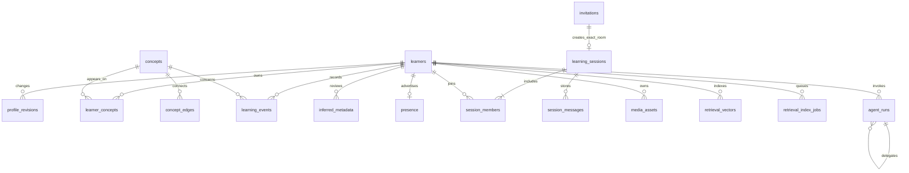

# Data model v1: the notebook, the shared dictionary and the connection

The learning map is the core experience. Its facts belong in a relational database; vectors help retrieve related material but do not decide what is true. This version supports the selected Connor/Sirpreet direction and keeps inference, transport and storage separate.

## What runs locally

The default repository runs **PGlite, an embedded PostgreSQL engine**, inside the server process, with pgvector loaded from the official extension package. It persists under `.local/data/pglite`. It needs neither a Supabase account nor a separate database daemon. This is actual PostgreSQL SQL and vector storage, not a JSON file pretending to be a database.

The local engine has one exclusive connection. One application process owns one directory; the adapter adds a process-owner lock to prevent accidentally starting two servers against the same files. The browser talks to the server and does not open the data directory. Multiple browser sessions can share that server.

`FurtherRepository` isolates the application from the engine. The same schema and repository now run against either PGlite or Aurora PostgreSQL through Data API. The AWS mode keeps the database private, connects over HTTPS using the server's AWS role, and uses Cognito identity while the UI, API and agents run locally. Ordered migrations acquire a transaction-scoped advisory lock so teammates can start against the shared database concurrently. This does not establish production throughput, restore readiness or population-scale retrieval quality.

Official references checked November 1, 2026: [PGlite getting started](https://pglite.dev/docs/), [PGlite API and transactions](https://pglite.dev/docs/api), [pgvector extension](https://pglite.dev/extensions/). The current extension is the separate package `@electric-sql/pglite-pgvector`.

## Entities and ownership

| Entity | What it means | Ownership and change rule |
|---|---|---|
| `learners` | Display name, background, explicit preferences, current intent, language, opt-in and time available | Private to the learner; updates create a revision. Current intent is separate from lasting preferences. |
| `profile_revisions` | What explicitly changed in the profile | Private history; a model inference does not silently overwrite it. |
| `concepts`, `concept_edges` | Reusable topic dictionary and prerequisite/related/part-of relationships | Canonical conceptual material, not raw personal context. Existing concept definitions are not overwritten by another learner's generated response. |
| `learner_concepts` | The concepts on one person's map | Private membership over the common dictionary. |
| `learning_events` | Opening, skipping, explaining, source use and session participation | Append-only through the repository; actor plus idempotency key is unique. All progress is replayed with the same TypeScript rules used by the UI. |
| `inferred_metadata` | A model's proposed interpretation of intent or matching attributes | Private, versioned and attributed. The latest intent-proposal has a bounded private learning-text vector; original records and provenance remain separate from the derived representation. |
| `presence` | A short-lived signal that someone is available | Expires by TTL; requires matching opt-in and adult confirmation. |
| `invitations` | A connection proposed to two people | Explicit separate acceptances, expiration, recent-decline suppression and exact session ID. |
| `learning_sessions`, `session_members`, `session_messages` | The shared room, its members and messages | Only members read or write. An ended or blocked conversation rejects new messages. |
| `blocks`, `reports` | A persistent boundary or recorded concern | Blocks affect matching, invitation acceptance and message delivery, and immediately close active shared rooms without learning credit. Reports use the selected database; there is no claim of an external moderation team. |
| `agent_runs` | A record of an invocation and its parent run | Scoped to one learner. Parent-child links cannot cross learners. Store safe summaries, not secrets. |
| `media_assets` | Image/audio/document metadata and extraction provenance | Bytes live separately in local storage or the configured private S3 bucket; relational records reference paths, hashes and size. Media reads require the owning learner. |
| `retrieval_vectors` | Derived text features used to find related information | Owner-scoped, partitioned by entity type, model and revision; 768 dimensions. Discovery can score only the eligible active concept projection, never private peer text. |
| `retrieval_index_jobs` | Durable current-source indexing work | One row per owner/entity/model/revision; content hash, generation, lease, attempt count, state and retry time prevent duplicates and stale publication. |

## Matching is a limited projection of the map

`listCandidates(actorId)` first checks that the requesting learner is eligible. It then filters peers for opt-in, adult confirmation, same language, unexpired presence, mutual blocks and recent declines. Learners already in an active room are unavailable for a new match. The returned projection contains only:

- Public display name and opaque ID.
- Up to five active concepts and their progress values.
- Language, available minutes and recent presence time.

It does **not** contain raw intent text, private background, preferences, learning-event payloads, inferred metadata or media. The peer-guide agent may explain or rank this supplied set; it must not discover arbitrary learners or relax filters. Available minutes are stored and projected; any minimum overlap policy must be applied by the matching service before offering an invitation.

The retrieval adapter's `searchPeerVectors` uses this same eligible projection and exact PostgreSQL cosine distance over stored active-concept embeddings. Its queries use owned selected concepts; peer targets are only consented active concepts. Results contain paired concept IDs/titles and similarity, not peer intent, inferred metadata or raw vector values. Canonical IDs may differ. Source hashes and model/revision must match current source content; stale or processing representations are excluded. Geomind and peer-guide consume the shared matching service built on this adapter. Browsing and ranking do not create invitations.

Available-now consent remains the scope. The full personal map is private; matching opt-in does not authorize offline public profiles or exposure of the entire map. Geography is neither collected nor inferred. Active candidates and invitations are checked against authoritative state even when vectors were produced asynchronously. A cross-concept invitation records both canonical topic IDs. Each person's completion event stays attached to their own concept, and pending reservations preserve that directional pair.

The present candidate query scans all eligible learners and replays their histories before response truncation. It is not a bounded population-scale search. A later consented projection table, updated from learning events and sharing changes, could supply indexed topical shortlists without replaying every history. Revocation and invitation checks must remain authoritative even if projections or caches become asynchronous.

Canonical concept definitions are a shared dictionary. Do not insert identifying or sensitive text into a title or hook. If personalized/private concept descriptions are required later, add a separate learner-owned annotation entity rather than weakening this boundary.

## What needs embeddings

| Data | Embed? | Reason |
|---|---|---|
| Short current-intent/matching description | Yes, as a private derived representation | Helps compare different wording about the same need. It remains distinct from the original text and confirmed fields. |
| Topic title and concise generic explanation | Yes, when attached to the learner's map | Helps retrieve related concepts and possible duplicates. Similarity is a candidate signal, not an automatic merge. |
| Resource/document/transcript chunks | Yes, after authorized ingestion | Retrieval can supply relevant portions to the learning companion. Store entity/chunk ID, text hash and model revision. |
| Explicit language, available time, adult confirmation, consent, blocks and session membership | **No** | These are exact constraints; fuzzy similarity must never override them. |
| Raw image/audio bytes | Not in the text-vector column | Keep original bytes locally. A Meta perception/transcription step may create text that can be indexed, with its provenance. Dedicated visual embedding spaces require their own dimension/model partition. |
| Provider credentials, auth tokens or private system configuration | **Never** | These are not learning content. |

The first local text index is 768-dimensional and model-agnostic within that dimension. The selected local Meta feature extractor is configured by the retrieval service. RoBERTa masked-mean features use a frozen-reference mean subtraction and renormalization; they remain a baseline, not a retrieval-trained sentence model; quality must be measured before using them for strong semantic or matching claims. The schema records exact model/revision and content hash so indexes can be rebuilt when the model changes. No hosted embedding API is assumed.

Exact cosine search is sufficient for the initial local corpus. An HNSW index is deliberately deferred until corpus size and measured recall/latency justify it. A vector is not a knowledge assertion, and an approximate-neighbor result cannot itself grant visibility or membership.

## Atomic transitions

1. `addConcepts` inserts canonical topics, the learner's membership, one seed event per topic and default-space indexing work in one transaction. Retrying does not create new seed events or re-embed unchanged content. Parent-to-child `part_of` writes reject newly introduced cycles; a shared transaction advisory lock serializes the cycle-check/write boundary across AWS clients. Existing legacy graphs remain readable through bounded UI traversal.
2. `recordEvent` accepts an explicit idempotency key. Concurrent retries recover the same committed event after a uniqueness conflict. The same key cannot be reused for another concept or event kind.
3. `invite` reuses an existing pending invitation for the unordered pair. Declines, opt-out, blocks and stale availability prevent new offers.
4. `respondToInvite` locks the invitation row. Neither side is assumed to have accepted. The second acceptance creates one session, records both members and stores that exact session ID on the invitation.
5. `completeSession` locks the room. It may end an empty room, but progress is recorded only if both members sent human messages. One session event per person uses a stable idempotency key. Participation credit is an application heuristic, **not proof of understanding**.
6. `appendMessage` deduplicates by session, submitting learner and request key. Reusing that key with different text, kind or provenance is a conflict. `block` ends active shared rooms without granting participation credit, including when both people already spoke.
7. All progress reads use `lib/math.ts`. SQL does not maintain a second copy of the mastery formulas.
8. A changed current intent and its indexing request are committed together. An intent-proposal and its selected learning-metadata projection are likewise atomic; only the latest proposal keeps derived vectors, while metadata history remains intact. Workers claim leased jobs; content changes invalidate old leases. Completion verifies owner, lease, current source hash and embedding space, then publishes the vector and ready state atomically. Failure remains retryable with safe status. Startup/status reconciliation repairs older data and restart recovery reclaims expired leases. See [retrieval](../retrieval/README.md).

## Storage sizing and future separation

A 768-dimensional float32 vector has roughly 3 KB of raw numeric payload before PostgreSQL row/index overhead. A thousand vectors therefore use roughly 3 MB of numeric payload, plus text, metadata and database files. Model weights and media will dominate early disk usage. Audio/video retention can grow much faster than text; store originals in the local media directory and avoid unnecessary duplication in traces.

The selected AWS mode stores relational facts, graph edges, durable indexing jobs and vectors together in Aurora PostgreSQL and uses private S3 for media. UI, API, agents and the Meta embedding worker still run locally. Local rehearsals explicitly select PGlite and local media. Inference providers are configured separately; switching storage does not change the Meta-only inference rule.

## Verified and remaining

The repository and semantic indexing tests exercise durable queue reopen, expired leases, stale-result rejection, changed-only embedding, safe retries, cross-ID cosine search, private-intent exclusion, revoked discovery, cross-topic session ownership, hierarchy cycle rejection, durable reopen, private map/metadata boundaries, idempotent events, consent filters, mutual blocks, exact-room acceptance, repeated/concurrent completion, empty/one-sided-room behavior, vector model/revision/actor isolation, media ownership, run lineage and the directory lock.

`tests/backend-http.test.ts` exercises the built application through independent cookie jars against an isolated fixture-mode server. It covers empty real maps, cookie/origin guards, profile and event isolation, malformed match requests, busy-peer exclusion, dual acceptance, shared messages and facilitator retries, concurrent completion, block/report boundaries, and persisted agent retry behavior. Run it with `FURTHER_TEST_URL=http://127.0.0.1:3001 npx tsx --test tests/backend-http.test.ts` after starting that isolated server with `FURTHER_MODEL_MODE=fixture`; it skips when no test URL is supplied and refuses nonlocal origins or a nonfixture server.

The repository receives a trusted server-created identity from the account session. In AWS mode, Cognito verifies signup/sign-in; a stable provider subject links to the relational learner and the server issues its opaque session. Synthetic persona switching is disabled in AWS mode and cannot select a real account in local development. Migration `002_accounts.sql` adds the account/session tables described in [authentication](../AUTHENTICATION.md); migration 004 adds Cognito identity support. Authorization is enforced by repository ownership and consent checks using the privileged server role, rather than database row-level security. Deletion/retention workflows, backup restoration, large-corpus retrieval quality and measured distributed concurrency remain separate work. Keep those limits visible when describing the build.

## Aurora Data API transport

`FURTHER_DATA_BACKEND=aurora-data-api` selects the same repository and migrations through a private SQL transport. Configure `AWS_REGION`, `FURTHER_AURORA_RESOURCE_ARN`, `FURTHER_AURORA_SECRET_ARN` and `FURTHER_AURORA_DATABASE`. AWS SDK credentials resolve server-side through the normal provider chain, including a local SSO profile. The application supplies a Secrets Manager ARN to Data API; it never fetches or prints the database password. Browser bundles receive neither AWS credentials nor provider tokens.

`domains/data/sql.ts` defines the query/transaction port and explicitly marks JSON and UUID-column parameters. PGlite unwraps those markers; the Data API driver translates positional placeholders lexically while leaving quoted strings, comments and dollar-quoted SQL bodies intact. UUID bindings carry a Data API type hint; UUID-looking concept text or provider subjects remain text. JSONB, vectors and PostgreSQL arrays retain their SQL types through explicit casts. All migrations are ordered and locked against simultaneous teammate startup.

Data API normally limits a returned row to 64KiB and a response to 1MiB. Reads project logical rows into 4Ki-character JSON fragments. A bounded first page handles small reads in one request; larger results use a transaction-scoped server cursor and bounded fetches. This preserves large agent-run JSON and complete snapshots without silently truncating them. The current adapter has an explicit 32MiB assembled-result ceiling; a larger caller must introduce a smaller API page or branch. Mutation `RETURNING` projections are serialized and fragmented inside PostgreSQL in one execution, preserving UUID arrays such as invitation acceptances without unsupported native Data API types. Those domain projections are bounded small rows and are not a bulk export API. SQL transactions retain invitation/session/index-job atomicity; intentional domain validation errors survive rollback. The adapter retries explicit `DatabaseResumingException` responses while a scale-to-zero cluster wakes, with 45 seconds of bounded scheduled delay. Explicitly rejected `ThrottlingException`/`TooManyRequestsException` responses use bounded exponential full jitter across statement and transaction calls. Unknown network, timeout and commit outcomes are not replayed.

Requests inside one transaction are queued because Data API rejects concurrent operations on one transaction ID. Separate transactions and ordinary reads run independently; there is no process-wide transaction lock. This prevents accidental `Promise.all` calls from breaking a transaction while allowing separate browser requests to progress concurrently. Generic SDK request retries are disabled for this client to avoid replaying a mutation or commit whose result is uncertain. Execute, begin, commit and rollback retry only explicit cancelled/rejected requests: `DatabaseResumingException`, `ThrottlingException` and `TooManyRequestsException`.

The explicit cancelled-request resume path permits seven attempts with 45 seconds of scheduled delay in total, plus request time. AWS documents a typical resume near 15 seconds and potentially more than 30 seconds after a long idle. The separate throttle-rejection path permits five retries with exponential full jitter capped at eight seconds per delay (less than 23 seconds of scheduled delay in total). An unavailable database, generic server error, network failure or unknown commit outcome is surfaced rather than replayed. See [Aurora auto-pause and resume](https://docs.aws.amazon.com/AmazonRDS/latest/AuroraUserGuide/aurora-serverless-v2-auto-pause.html) and [AWS retry behavior](https://docs.aws.amazon.com/sdkref/latest/guide/feature-retry-behavior.html).

Cognito accounts use the provider's stable subject in migration 004. Email equality never grants access to an old account or learner map. A new provider subject creates a separate learner; a repeated subject restores its existing account. Profile content, usernames and learning records remain in the existing relational model. Local password hashes are not copied into Cognito.

`tests/aurora-data-api.test.ts` executes driver-generated SQL through a real PGlite/pgvector-backed transport double. Its parameter types model Data API/JDBC VARCHAR and UUID bindings so convenient local type inference cannot hide missing cloud casts. Coverage includes multi-page large Unicode rows, unsafe-integer rejection, transaction concurrency, rollback, repository graph/index/vector/Cognito behavior and a complete shared room.

Live AWS acceptance on November 2, 2026 verified ordered migrations and pgvector, a Unicode JSON result above 64KiB through the transaction-scoped cursor, stable Cognito-subject account persistence without email takeover, rollback, concurrent calls inside one transaction, topic hierarchy/cycle rejection, jobs surviving a fresh repository, leased publication and exact vector distance, opaque sessions, dual invitation acceptance with UUID arrays, shared messages, completion credit, agent-run persistence and block/report writes. These runs used isolated synthetic records, removed them afterward and did not migrate local learners or call model APIs. Private acceptance receipts are under ignored `.local/verification/`; Cognito's real signup/JWT flow is verified separately from database identity persistence.

Sources: [ExecuteStatement](https://docs.aws.amazon.com/rdsdataservice/latest/APIReference/API_ExecuteStatement.html), [SQL parameters and type hints](https://docs.aws.amazon.com/rdsdataservice/latest/APIReference/API_SqlParameter.html), [Data API troubleshooting and result limits](https://docs.aws.amazon.com/AmazonRDS/latest/AuroraUserGuide/data-api.troubleshooting.html).
