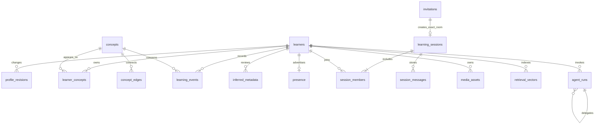

# Data model v1: the notebook, the shared dictionary and the connection

The learning map is the core experience. Its facts belong in a relational database; vectors help retrieve related material but do not decide what is true. This version supports the selected Connor/Sirpreet direction and keeps inference, transport and storage separate.

## What runs locally

The default repository runs **PGlite, an embedded PostgreSQL engine**, inside the server process, with pgvector loaded from the official extension package. It persists under `.local/data/pglite`. It needs neither a Supabase account nor a separate database daemon. This is actual PostgreSQL SQL and vector storage, not a JSON file pretending to be a database.

The local engine has one exclusive connection. One application process owns one directory; the adapter adds a process-owner lock to prevent accidentally starting two servers against the same files. The browser talks to the server and does not open the data directory. Multiple browser sessions can share that server.

This is a development configuration, not a claim of production throughput. `FurtherRepository` isolates the application from the engine. A future native PostgreSQL adapter can reuse the schema and parameterized SQL, but that adapter, migrations under rolling deployments, connection pooling, backups and production authorization are **not implemented by this change**.

Official references checked November 1, 2026: [PGlite getting started](https://pglite.dev/docs/), [PGlite API and transactions](https://pglite.dev/docs/api), [pgvector extension](https://pglite.dev/extensions/). The current extension is the separate package `@electric-sql/pglite-pgvector`.

## Entities and ownership

| Entity | What it means | Ownership and change rule |
|---|---|---|
| `learners` | Display name, background, explicit preferences, current intent, language, opt-in and time available | Private to the learner; updates create a revision. Current intent is separate from lasting preferences. |
| `profile_revisions` | What explicitly changed in the profile | Private history; a model inference does not silently overwrite it. |
| `concepts`, `concept_edges` | Reusable topic dictionary and prerequisite/related/part-of relationships | Canonical conceptual material, not raw personal context. Existing concept definitions are not overwritten by another learner's generated response. |
| `learner_concepts` | The concepts on one person's map | Private membership over the common dictionary. |
| `learning_events` | Opening, skipping, explaining, source use and session participation | Append-only through the repository; actor plus idempotency key is unique. All progress is replayed with the same TypeScript rules used by the UI. |
| `inferred_metadata` | A model's proposed interpretation of intent or matching attributes | Private, versioned and attributed. Model, run, confidence and confirmation status stay separate from the values. |
| `presence` | A short-lived signal that someone is available | Expires by TTL; requires matching opt-in and adult confirmation. |
| `invitations` | A connection proposed to two people | Explicit separate acceptances, expiration, recent-decline suppression and exact session ID. |
| `learning_sessions`, `session_members`, `session_messages` | The shared room, its members and messages | Only members read or write. An ended or blocked conversation rejects new messages. |
| `blocks`, `reports` | A persistent boundary or recorded concern | Blocks affect matching, invitation acceptance and message delivery, and immediately close active shared rooms without learning credit. Reports are stored locally; there is no claim of an external moderation team. |
| `agent_runs` | A local record of an invocation and its parent run | Scoped to one learner. Parent-child links cannot cross learners. Store safe summaries, not secrets. |
| `media_assets` | Local image/audio/document metadata and extraction provenance | Local bytes live separately; relational records reference paths, hashes and size. Media reads require the owning learner. |
| `retrieval_vectors` | Derived text features used to find related information | Private to the learner, partitioned by entity type, model and revision; 768 dimensions in this first text index. |

## Matching is a limited projection of the map

`listCandidates(actorId)` first checks that the requesting learner is eligible. It then filters peers for opt-in, adult confirmation, same language, unexpired presence, mutual blocks and recent declines. Learners already in an active room are unavailable for a new match. The returned projection contains only:

- Public display name and opaque ID.
- Up to five active concepts and their progress values.
- Language, available minutes and recent presence time.

It does **not** contain raw intent text, private background, preferences, learning-event payloads, inferred metadata or media. The peer-guide agent may explain or rank this supplied set; it must not discover arbitrary learners or relax filters. Available minutes are stored and projected; any minimum overlap policy must be applied by the matching service before offering an invitation.

Canonical concept definitions are a shared dictionary. Do not insert identifying or sensitive text into a title or hook. If personalized/private concept descriptions are required later, add a separate learner-owned annotation entity rather than weakening this boundary.

## What needs embeddings

| Data | Embed? | Reason |
|---|---|---|
| Short current-intent/matching description | Yes, as a private derived representation | Helps compare different wording about the same need. It remains distinct from the original text and confirmed fields. |
| Topic title and concise generic explanation | Yes, when attached to the learner's map | Helps retrieve related concepts and possible duplicates. Similarity is a candidate signal, not an automatic merge. |
| Resource/document/transcript chunks | Yes, after authorized ingestion | Retrieval can supply relevant portions to the learning companion. Store entity/chunk ID, text hash and model revision. |
| Explicit language, available time, adult confirmation, consent, blocks and session membership | **No** | These are exact constraints; fuzzy similarity must never override them. |
| Raw image/audio bytes | Not in the text-vector column | Keep original bytes locally. A Meta perception/transcription step may create text that can be indexed, with its provenance. Dedicated visual embedding spaces require their own dimension/model partition. |
| Provider credentials, auth tokens or private system configuration | **Never** | These are not learning content. |

The first local text index is 768-dimensional and model-agnostic within that dimension. The selected local Meta feature extractor is configured by the retrieval service. RoBERTa mean-pooled features are a baseline, not a retrieval-trained sentence model; quality must be measured before using them for strong semantic or matching claims. The schema records exact model/revision and content hash so indexes can be rebuilt when the model changes. No hosted embedding API is assumed.

Exact cosine search is sufficient for the initial local corpus. An HNSW index is deliberately deferred until corpus size and measured recall/latency justify it. A vector is not a knowledge assertion, and an approximate-neighbor result cannot itself grant visibility or membership.

## Atomic transitions

1. `addConcepts` inserts canonical topics, the learner's membership and one seed event per topic in one transaction. Retrying does not create new seed events.
2. `recordEvent` accepts an explicit idempotency key. The same key cannot be reused for another concept or event kind.
3. `invite` reuses an existing pending invitation for the unordered pair. Declines, opt-out, blocks and stale availability prevent new offers.
4. `respondToInvite` locks the invitation row. Neither side is assumed to have accepted. The second acceptance creates one session, records both members and stores that exact session ID on the invitation.
5. `completeSession` locks the room. It may end an empty room, but progress is recorded only if both members sent human messages. One session event per person uses a stable idempotency key. Participation credit is an application heuristic, **not proof of understanding**.
6. `appendMessage` deduplicates by session, submitting learner and request key. Reusing that key with different text, kind or provenance is a conflict. `block` ends active shared rooms without granting participation credit, including when both people already spoke.
7. All progress reads use `lib/math.ts`. SQL does not maintain a second copy of the mastery formulas.

## Storage sizing and future separation

A 768-dimensional float32 vector has roughly 3 KB of raw numeric payload before PostgreSQL row/index overhead. A thousand vectors therefore use roughly 3 MB of numeric payload, plus text, metadata and database files. Model weights and media will dominate early disk usage. Audio/video retention can grow much faster than text; store originals in the local media directory and avoid unnecessary duplication in traces.

The interface can later separate relational storage, blob storage and retrieval workers. That separation need not be separate cloud services today. Current files and SQL stay local; inference providers are configured elsewhere.

## Verified and remaining

The repository tests exercise durable reopen, private map/metadata boundaries, idempotent events, consent filters, mutual blocks, exact-room acceptance, repeated/concurrent completion, empty/one-sided-room behavior, vector model/revision/actor isolation, media ownership, run lineage and the directory lock.

`tests/backend-http.test.ts` exercises the built application through independent cookie jars against an isolated fixture-mode server. It covers empty real maps, cookie/origin guards, profile and event isolation, malformed match requests, busy-peer exclusion, dual acceptance, shared messages and facilitator retries, concurrent completion, block/report boundaries, and persisted agent retry behavior. Run it with `FURTHER_TEST_URL=http://127.0.0.1:3001 npx tsx --test tests/backend-http.test.ts` after starting that isolated server with `FURTHER_MODEL_MODE=fixture`; it skips when no test URL is supplied and refuses nonlocal origins or a nonfixture server.

The repository receives a trusted server-created identity. The local persona chooser intentionally permits switching between development profiles; it is not production account authentication. The repository's privileged local connection is not a deployed row-level-security system. Production policies, native PostgreSQL adapter, deletion/retention workflows, backup restore, large-corpus retrieval quality and distributed concurrency remain separate work. Keep those limits visible when describing the build.
