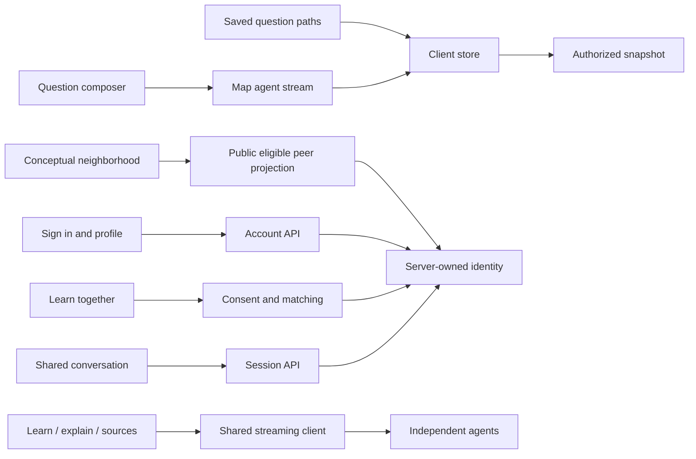

# UI domain: the map workspace

Composition (November 2): the radial knowledge map fills the screen; one side panel on the right (`components/mission/SidePanel.tsx`) holds the saved-question switcher at the top, the current question's path or the open concept/topic/learner card in the middle, a one-line progress summary plus Find someone to learn with, and the question composer at the foot (`CommandBar` `panel` variant). On desktop the panel is resizable (`components/mission/PanelResizer.tsx`): drag the grip on its left edge, use arrow keys when the grip is focused, double-click to reset, or use the widen/restore button in the panel header. Width is remembered per device (`further:panel-width`), kept between 320px and the window width minus 380px so the map's controls still fit, and the map refits when a drag ends. A wide panel centres its content and composer at a readable line length. On phones the panel becomes a bottom sheet with a drag handle; it opens automatically when a card is selected. Progress buckets, recent activity, sessions and connections live on Profile (`components/mission/History.tsx`). The Session tab is shown only while a pending match or live session exists. Keep the dark palette, warm action colour and cyan accents. The shared persona-labelled ActivityPanel is retained; a finished run always collapses to a one-line Response ready row, carrying any follow-up notice with it.

## Experience

1. **Arrive.** Signed-out visitors see a compact account entry card with Create account and Sign in. An account starts with an empty workspace, not sample people or a sample graph.
2. **Ask.** One composer accepts a question, a reviewed voice transcript, or a photo-derived question. Voice transcription begins after recording stops. Images and voice do not silently submit their inferred text. The photo's Explore confirmation starts a path.
3. **Choose a starting point.** A successful expansion creates its own saved question and topic list. The existing radial canvas focuses on that question. Three small canvas controls distinguish This question, My knowledge map and Geomind. The saved-question selector at the top of the side panel selects a learning focus; its path lists the question's concepts in suggested order. A question is never a dead end: **Keep exploring this question** (below the path) and **Go deeper** / **Explore further** (on a concept card) call the map agent with a `focus` and `extendsRunId`, so 3–5 new concepts attach under the chosen concept and join the same question's path. `domains/backend/missions.ts` merges those deeper runs into their parent question when the snapshot is rebuilt; a proposal that would re-add the focused concept as its own child is dropped before saving. Starting an unrelated question switches the focus without changing the layout. Shared concepts retain their learning evidence across paths.
4. **Learn one idea.** The topic surface offers Learn, Try explaining and Sources. Selecting a topic restores its saved lesson, including after a reload. A model request is made when there is no matching lesson or when the learner explicitly chooses Explain another way. Source search runs only when Sources is selected. Switching activities does not mount duplicate lessons or inspectors.
5. **Check with your own words.** Typed or reviewed transcribed explanations receive real streamed AI feedback. Saved feedback is restored when returning to a topic. Learning participation is not presented as a mastery percentage or a game level. The interface describes reviewed explanations as evidence, not certification.
6. **Read the entire map.** The v1 radial canvas, relationships, glow and pan/zoom remain. This question shows its focused concept graph. My knowledge map starts with concise topic summaries across all saved learning, including older concepts. Clicking a summary zooms into its original concepts; a leaf opens the existing lesson inspector. Breadcrumb/back and zoom-out restore the overview. Summary nodes use counts and neutral styling rather than synthetic learning scores. **Review** (bottom-left of the map, `components/mission/Review.tsx`, pure logic in `lib/review.ts`) opens in the side panel: Slipping lists concepts explained then untouched for four or more days with an Explain again action; This week compares added/opened/explained/sessions with the previous week; Pick up where you left off resumes an unfinished question at its most recently touched concept. The growth replay (time-lapse scrubber) is reached from Review. A concept card's Try explaining tab lists earlier reviewed explanations with their feedback. All of it derives from the learner's own event log and is framed as practice prompts, not grades. The full question remains available in the selector and hub tooltip.
7. **Find another perspective.** Geomind groups eligible available learners around shared ideas. Its inspector explains why a connection is relevant, and an explicit invitation rechecks eligibility server-side. No people are fabricated when the community is empty. Find someone to learn with also sits in the side panel's summary row, scoped to the current question. Availability, adult-pilot confirmation, language and time stay explicit. Matching does not automatically interrupt a solo lesson after every explanation. Both people still accept before the shared text conversation opens. Offline community discovery and physical location are not part of the current matching consent.
8. **Return.** Question history and current-path preference restore by learner. Session history resolves authorized peer names and avoids exposing raw UUIDs. Profile contains account identity, optional learning context and availability.

The personal guide can advise using the saved map. Planning is read-only: it does not create a new quest or change the current learning goal. When a suggested topic already belongs to a path, the guide offers an Open action that selects the appropriate saved question and topic.

Concept and overview-topic nodes include a small completed-learner counter. Each person counts once after a saved 3/3 AI-reviewed explain-back; a topic requires that person to have explained every member concept. Badges expose anonymous totals and explain that completion is evidence, not certified mastery. Counts load independently of the map/LLM, refresh after saved feedback, and poll every 20 seconds while the page is focused (also on refocus). Errors show a retry action instead of fake zeros. Sample maps and historical replay do not show current community counts.

Saved lessons are scoped to the account, concept, depth instruction and live/fixture mode. They are read from successful persisted agent runs, validated again before returning, and never borrowed from another account or from demonstration requests. A changed lesson instruction starts a fresh version. Completing practice records the exact lesson run; completing an older version cannot hide a replacement lesson's practice. Interrupted requests keep their original retry key, while a confirmed failure before saving may start a fresh attempt.

## Authentication surfaces

`/signup` and `/login` use the real `/api/auth/*` endpoints. Signup collects name, unique username, email and password; it does not claim email ownership has been verified. Google sign-in is shown as available only when the session response reports configured OAuth credentials. Google OAuth is parked at the user’s request; when unconfigured, its button and setup prompt are omitted, and email signup remains usable. No fake federation result or client-generated account is used.

Successful login/signup and logout perform a hard navigation, clear the active workspace by replacing the store, and notify other tabs through the identity-change key. Account details are edited through `/api/auth/account`; learning preferences use `/api/data/profile`. Their save acknowledgements are separate. Test-persona selection is visible only when the backend explicitly enables local test profiles. It is not a substitute for account sign-in.

Profile's **Reset learning map** action reveals a separate permanent-deletion confirmation. It clears all saved questions, map concepts, progress, and generated learning history, while keeping the account/profile, uploaded images, and shared conversations. Sample-map mode, pending writes, guide work, and active conversations/invitations disable the action; the backend independently guards active work. Errors stay visible, and retries reuse the same request key. Success hard-navigates to the Map page and broadcasts `further:map-reset:v1`, so other tabs reload instead of merging old missions or drafts back into the cleared map.

## Boundaries

UI reads public contracts and HTTP endpoints, never database drivers or model credentials. `lib/client/learning-paths.ts` scopes topic views to question runs, preserves shared concepts, orders prerequisites and leaves cycles bounded. `lib/client/store.tsx` owns authenticated snapshots and event-derived state. `lib/client/live.ts` owns same-origin requests and explicit fixture headers.

`lib/client/use-geomind.ts` loads the authenticated neighborhood when that view opens, then only through Refresh or an explicit retry button. It does not poll or reload on browser focus, visibility, profile/activity changes or invitation outcomes. Leaving the view or changing accounts cancels obsolete requests; failed refreshes clear stale results. A successful no-neighbor result leaves the map unobstructed, without an empty-neighborhood card. Loading, error, consent and indexing notices remain visible. Peer selection stays separate from topic selection. Discovery is a database operation, not simulated AI streaming. The public DTO is in `lib/geomind.ts`; private data and eligibility stay on the server. See [Geomind](../GEOMIND.md) for the consent and scaling boundaries.

`lib/client/use-knowledge-overview.ts` checks the owner's saved summary before requesting streamed generation. It invalidates on concept/relationship changes and isolates obsolete responses by actor and graph revision. `KnowledgeMap` receives distinct aggregate groups and real concept records; it renders one abstraction level at a time. Selecting a summary does not record a learning event or trigger a lesson call. Real member concepts retain their existing learning behavior. `KnowledgeOverviewInspector` summarizes the selected level without repeating the full leaf list.

Both overview requests carry the captured actor consistency header so a changed browser session cannot substitute a different account's result. A directly selected saved concept can still open its lesson while the derived overview is loading or unavailable. Narrow canvases arrange summary cards compactly and refit on meaningful width changes; desktop keeps the radial layout. Counts distinguish aggregate topics from underlying concepts. Reviewed, Exploring and Not started are mutually exclusive display buckets; this does not change stored learning evidence.

## Real streaming and progressive disclosure

Every AI flow requests `Accept: text/event-stream`. `useAIStream` consumes server events and resets only after a validated result. The shared ActivityPanel shows the current agent and actual stage immediately, a readable live response when text arrives, real elapsed time, and Stop/Try again controls. It emphasizes the most recent collaborator's readable draft; other contributions and the event history remain available under See steps. Completed work collapses to a small Response ready row rather than crowding the lesson.

Drafts are provisional. The graph and feedback only apply after the final validated envelope and persistence acknowledgement. Failed or interrupted drafts never become saved results. No artificial typing delay, guessed percentage, private reasoning, raw tool arguments or credentials are displayed. Ordinary saves and matching use operation status, not pretend token streaming.

Source citation provenance and link reachability remain different. A reachable URL is labelled Link opens. An unchecked URL is labelled Cited source · link not checked. An unavailable link is identified without declaring the entire lesson failed. Model content still requires judgment and useful source comparison.

## Data modes and remaining limits

Saved local accounts and real provider calls are the default. Explicit fixture mode labels model output as rehearsal. Explicit sample data is separate from real account state and does not silently replace failed reads. Profile save errors retain the draft. Human-message failures retain the composer text; server-persisted results are never posted again as duplicate learning events.

The room remains text-based, with local polling. Reports remain local records. There is no implied live community when presence is empty, no voice/video call, no production email delivery or account recovery, and no external MCP/A2A connection claim. The architecture page reads all ordered migrations, current agent contracts and provider routing, with configuration distinguished from live verification.

## Verification

`tests/ui-learning-paths.test.ts` covers unrelated-question isolation, shared concepts across questions, missing/pending topics, prerequisite order and cycles. `tests/ui-lesson-state.test.ts` covers exact lesson completion and replacement behavior. Route and repository tests cover lesson reuse without inference, explicit replacement, depth/account/mode isolation and restoration after reopening the database. Existing UI tests cover WAV encoding, profile field boundaries, mission rehydration, SSE framing and cancellation. Account and HTTP tests validate identity/owner boundaries separately.

Browser acceptance should verify signup/signin/logout, Google-unconfigured messaging, the map-plus-side-panel composition, first question → lesson → explanation, switching saved question focus without losing work, visible persona-labelled streaming, explicit source search, matching consent and the phone bottom sheet. No unit test is a physical microphone test or proof of Google federation without a real configured OAuth round-trip.

## Nested knowledge navigation

The cumulative map now keeps a breadcrumb stack, rather than one selected group ID. Each level shows its immediate topic/subtopic containers; leaves open the original canonical concepts. Click a breadcrumb to jump out, use the central node or ↑ to return one level, or zoom out past the current fitted view. A wheel gesture settles before it can leave another level. Wide levels show twelve containers at a time with Previous/More controls; no unseen concepts are discarded. Ordinary question focus and the map/side-panel composition remain intact.

Topic summaries come from real bounded Meta `summarize` calls and are durable owner-only agent outputs. Branches with more than four concepts check the saved branch summary before generating a narrower grouping. A response becomes a new semantic level only if it strictly narrows and exactly covers its parent; repeatedly returning the same group cannot cause an infinite drill-in. The UI displays actual streaming activity while subtopics are prepared, retains access to canonical concepts during a failed summary, and supports cancellation/retry.

Saved `part_of` edges also supply nested concept containers: the existing graph convention is parent `src` → child `dst`. The same canonical concept may be reached under multiple parents without duplicating its evidence. Invalid legacy cycles are bounded at the navigation boundary; no graph facts are deleted. A container's own lesson stays available through Learn this concept in its inspector. These graph relationships and the derived topic summaries remain separate kinds of information.

`POST /api/knowledge/overview/read` checks a branch cache using an owner-validated concept scope, without inference. Generation uses the same scope on the overview POST endpoint. Client-supplied raw model context is never accepted. Complete map hashes are independent of model request size. Oversized maps are summarized in size-aware batches of at most 120 concepts, then reduced through read-only child summaries tied to owned canonical representative IDs. Every original concept remains represented. The composed hierarchy is stored privately in `agent_runs`; individual batch/branch caches make retries reusable. Model inputs remain bounded at 200 concepts, 800 internal relationships and 160 KB; cross-batch relationships stay in the canonical graph and can still link the displayed topics. This is incremental context construction, not a claim of unlimited throughput or free inference.
