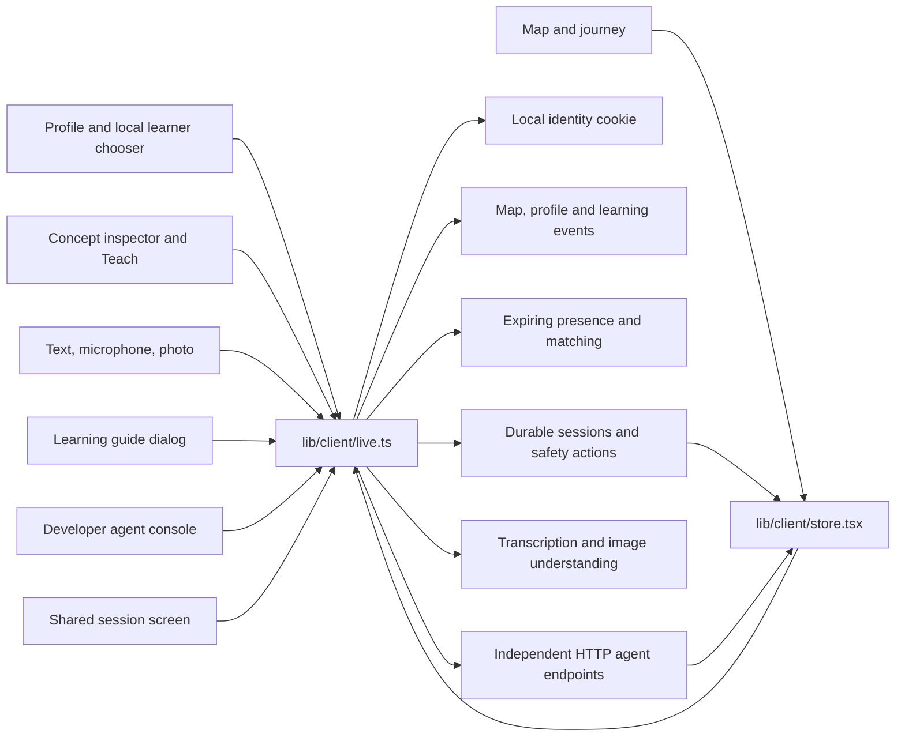

# UI domain: saved maps and collaborative learning

The Iteration-nov1 visual foundation remains: a personal concept map, a collapsible journey panel, a concept inspector and a compact curiosity bar. Newer learning-first behavior builds on those surfaces. The browser is a client of local services; it never imports a database connection or a provider credential.

## Data and model modes

The default is **saved local data**. `/api/data/bootstrap` restores the signed-in local learner's map, event history, profile, available peers, pending match and current room. A load failure stays visible. It does not replace a learner's map with samples.

The always-accessible `/architecture` page explains the domains, highlights direct dependencies, lists current agent cards, reads the SQL table inventory and displays public model routing plus health. Profile links to it as **How Further works**. It makes no inference request and exposes no credentials.

The explicitly labeled local-development panel on Profile can create/select local learners or choose the sample map, stored separately in the browser. Sample requests carry `x-further-demo: true`; even this mode initializes a local session first. No sample peer can silently accept an invitation or impersonate a second participant.

Model mode is independent of data mode. `modelMode: fixture` in bootstrap labels deterministic rehearsal responses while profiles, maps and conversations can still be saved locally. Every rendered fixture lesson, grade, photo interpretation and agent response is labeled. A null explain-back score is ungraded and earns no credit. Provider failures stay failures; the client does not substitute a fixture.

## Dependency map

## Client contracts

`domains/ui/contracts.ts` defines browser transport types. Agent inputs and results are shared from `domains/agents/contracts.ts`, imported as types only. `lib/client/live.ts` handles same-origin cookies, explicit sample headers and JSON errors.

| Surface | Endpoint | Behavior |
| --- | --- | --- |
| Startup | `GET /api/data/bootstrap` | Restore canonical server state, including actor-relative match/session pointers. |
| Developer learner chooser | `GET/POST /api/local/identity` | Create or select a local learner. Uses a signed HttpOnly cookie. |
| Profile | `PATCH /api/data/profile` | Save an explicit draft, including availability minutes. |
| Map interaction | `POST /api/data/events` | Ordered writes with a stable idempotency key; failed writes remain retryable in the tab. |
| Available peers | `POST /api/local/presence` | Visible-tab heartbeat every ten seconds. The server derives authoritative profile and matching data. |
| Expand curiosity | `POST /api/expand` | Stream real agent activity and provisional text; apply concepts only after the validated final result, then refresh saved state. Index warnings remain visible. |
| Concept and lesson | `GET /api/card/:slug`, `POST /api/teach` | Cancellable requests, visible errors and fixture labels. Lesson cache is separated by actor and data mode. |
| Explain back | `POST /api/explain` | Refresh server-persisted scoring; no duplicate learning event. Ungraded fixture output never changes mastery. |
| Voice input | `POST /api/transcribe` | Browser capture becomes mono 24 kHz, 16-bit PCM WAV. Real cumulative transcription updates replace the draft; the final result alone starts the next action. Tracks release on stop, error and navigation. |
| Photo question | `POST /api/media/understand` | Multipart `image`. The learner reviews the returned question before expanding the map. |
| Independent agent | `POST /api/agents/:id` | Shared agent contract; guide dialog calls knowledge-map, peer-guide or resource-guide. |
| Agent discovery | `GET /api/agents` | Developer console lists current cards and can invoke each agent with JSON input. |
| Match handshake | `GET/POST /api/match` | Poll pending and waiting states; both learners must accept. No automatic sample acceptance. |
| Room restore | `GET /api/local/sessions/:id` | Restore messages, peer, exchanged concepts and ended/blocked state. |
| Shared message/end | `POST /api/session/:id/message`, `/end` | Stable retry keys and server acknowledgement before claiming sent/completed. |
| Safety | `POST /api/local/sessions/:id/block`, `/report` | Durable block/report actions. Reports are stored locally, not sent to an outside team. |

A second independent learner needs a separate browser profile or isolated browser context. Tabs in the same browser share the cookie, so switching the developer persona changes that browser's identity and notifies its other tabs to reload. The chooser is a local development aid, not production sign-in.

The connector screen is now a local HTTP agent console. It does not claim MCP or A2A compliance, invent an external access token, or claim a Meta assistant is connected. External delegation and protocol adapters require their own implementation.

## Real progress and streamed responses

`lib/client/stream.ts` consumes the common SSE envelope. `lib/client/useAIStream.ts` manages cancellation and provisional state; `components/activity/ActivityPanel.tsx` renders safe activity and draft answers for every learner, independent of the builder flag. The panel shows actual agent and tool/delegation updates, elapsed time and an explanation when no new update arrives. It retains completion/error information and offers cancel/retry where relevant.

- Every AI request sends `Accept: text/event-stream` through the same-origin client. Activity comes from the server; the UI never animates a completed answer into a pretend stream.
- `AgentEvent` is imported from the runtime contract. Only approved readable fields enter the draft. A `thinking` event clears that agent's previous model-turn draft; `replace: true` replaces a field rather than appending it. This also handles cumulative ASR transcript corrections.
- Draft text is explicitly provisional. Only a `result` envelope resolves the request and permits the final lesson, graph, feedback or image question to be applied. An interrupted/error stream retains an unapplied draft and never becomes a successful result.
- Closing or cancelling aborts the client request. Cancellation does not undo a human message or other operation already saved by the server; the UI explains that distinction and rooms continue to refresh saved messages.
- Map expansion, guide, concept card, teaching, explain-back, photo understanding, voice transcription, shared-session facilitation and the developer agent console use the shared stream. The course endpoint supports the same transport for future callers; there is no separate mounted course screen.
- Profile/learning-event writes, room loading, identity changes and matching use `OperationStatus`, which describes database/consent work and elapsed time without pretending it is model output.
- Raw prompts, private tool results and model reasoning are never rendered. Model/provider configuration stays on development surfaces; public operational activity is visible during ordinary learning.

## Interaction and persistence details

- Only one concept inspector is mounted at a time across desktop and mobile. Hidden duplicate inspectors previously could trigger duplicate learning events and model requests.
- Practice challenge answers remain local feedback. Finishing the lesson records self-reported practice; only the server explain-back endpoint awards an assessment score.
- Opening a video or link does not count as completing it. A separate learner action marks completion.
- Profile edits remain a draft until Save changes succeeds. Text for failed messages stays in the composer. Failed learning-event writes retain their idempotency keys for Retry saving.
- Map events, concepts, profiles, matches, rooms and safety actions are server-owned. Tile positions are reconstructed deterministically for presentation. Quest history is restored from the learner's saved knowledge-map agent runs. Matching temporary entries are replaced while unrelated running/error attempts stay visible; UI selection remains presentation state.
- The session screen reads a room by URL and restores it after refresh, including finished or blocked rooms. It does not depend on a prior in-memory match modal.
- Polling is local development plumbing. Push transport can replace presence and room polling behind the same snapshots.
- There is voice input and image understanding. There is no implemented text-to-speech, generated-image learning flow, video call or external connector claim.

## Verification

Run the repository typecheck and lint commands with the available Node runtime. `tests/ui-audio.test.ts` checks that microphone capture produces the required WAV framing, mono PCM sample format, clipping and target-rate resampling. `tests/ui-profile.test.ts` verifies that server identity, revision and unknown nested fields cannot be sent back as profile edits. `tests/ui-missions.test.ts` checks quest rehydration, one-to-one temporary-entry replacement and preservation of unrelated in-flight attempts. `tests/ui-stream.test.ts` checks split UTF-8/CRLF, comments, multiline SSE, abort and connection interruption, final-result gating, cumulative transcript replacement, repair reset and suppression of private reasoning fields. Root integration tests cover the server contracts; browser QA should exercise the following together:

1. Fresh local learner starts with an empty map; reload preserves actual concepts and profile edits.
2. Two isolated browser contexts create distinct learners, share eligible concepts, opt in and accept a match independently.
3. Room messages reach the other context and survive reload. Finish, block and report persist.
4. A failed save shows an actionable error; retry uses the same idempotency key.
5. Sample mode and fixture AI are visibly distinguished from live inference and real people.
6. At phone width, only one inspector is mounted and guide/photo controls remain reachable.
7. Recording stops on navigation; photo submission asks for confirmation before map expansion.

No UI test constitutes a live provider check, microphone hardware check or production scale claim.
